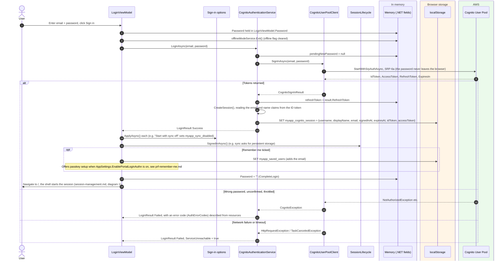
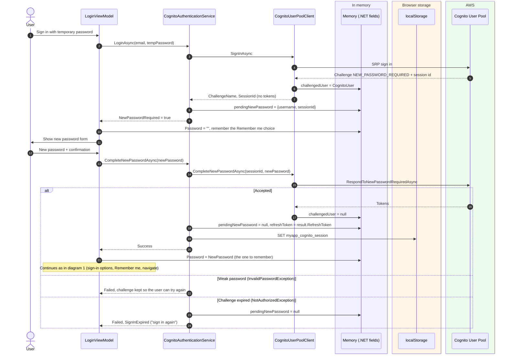
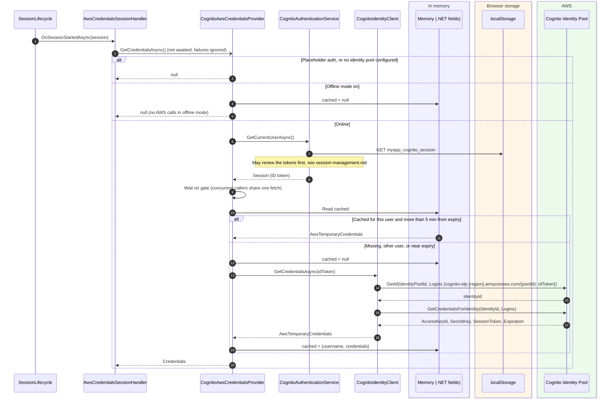
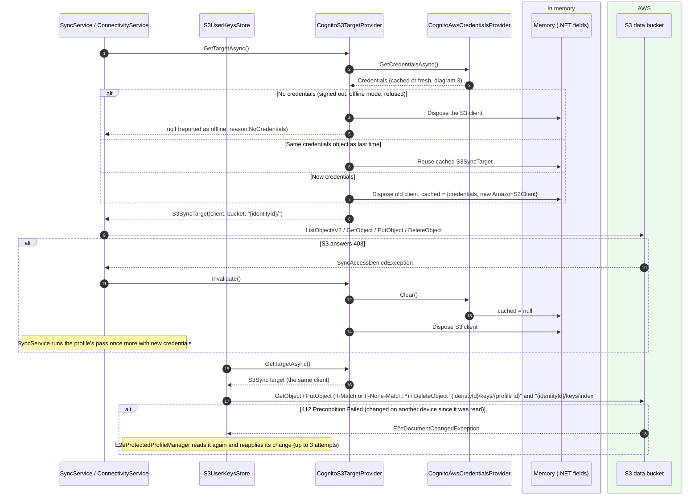
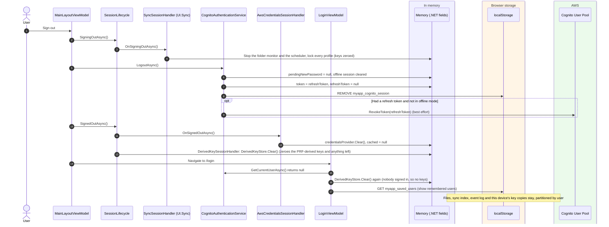
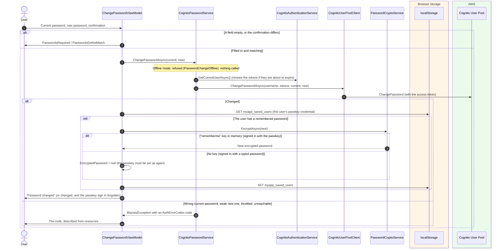
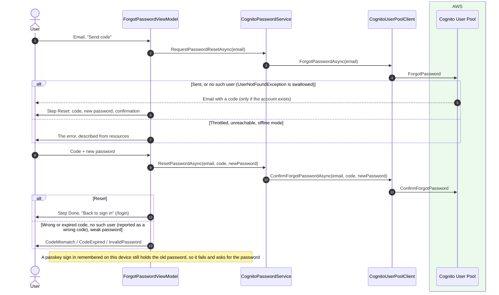

# Authentication (Cognito) and AWS credentials

How a typed email and password becomes a signed-in session, how that session becomes temporary AWS credentials for
the data bucket in S3 (the user's files and their end to end keys), and how passwords are changed and reset.

Main classes:

- `LoginViewModel` (`src/Devoctomy.Blazwiz.UI/ViewModels/LoginViewModel.cs`)
- `CognitoAuthenticationService` (`src/Devoctomy.Blazwiz.Auth.Cognito/Services/CognitoAuthenticationService.cs`)
- `CognitoUserPoolClient`, which uses `Amazon.Extensions.CognitoAuthentication` for SRP (`src/Devoctomy.Blazwiz.Auth.Cognito/Services/CognitoUserPoolClient.cs`)
- `CognitoAwsCredentialsProvider` and `CognitoIdentityClient` (`src/Devoctomy.Blazwiz.Auth.Cognito/Services/`)
- `AwsCredentialsSessionHandler` (`src/Devoctomy.Blazwiz.Auth.Cognito/Services/AwsCredentialsSessionHandler.cs`): a session lifecycle handler that fetches and forgets the credentials
- `CognitoPasswordService` (`src/Devoctomy.Blazwiz.Auth.Cognito/Services/CognitoPasswordService.cs`), behind `IPasswordService` (Auth)
- `ChangePasswordViewModel` and `ForgotPasswordViewModel` (`src/Devoctomy.Blazwiz.UI/ViewModels/`)
- `MainLayoutViewModel` (`src/Devoctomy.Blazwiz.UI/ViewModels/MainLayoutViewModel.cs`) and `SessionLifecycle` (`src/Devoctomy.Blazwiz.Auth/Sessions/SessionLifecycle.cs`)

`AddBlazwizCognito` registers `CognitoAuthenticationService` and `CognitoPasswordService` when the region, user pool
and app client are configured (`AwsCognito` in `appsettings.json`). When they are not, and the app allows it
(`allowPlaceholderSignIn`, the template passes the host environment's `IsDevelopment()`), `LocalAuthenticationService`
and `LocalPasswordService` (Auth) take their place: any non-empty credentials sign in, an 8 hour session is stored
under `myapp_session` in localStorage, and nothing calls AWS. When the app does not allow it, `AddBlazwizCognito`
throws, so a deployment missing its settings fails to start.

Storage names below use the template's app name, `myapp`: the storage clients add the prefix set with
`AddBlazwizApp` (`IAppStorageKeys`), so the code names them `cognito_session`, `saved_users` and so on.

## Where things are kept

| What | Where | Key / field | Lifetime |
|---|---|---|---|
| Session (username, display name, email, `SignedInAt`, `ExpiresAt`, **ID token**, **access token**) | localStorage | `myapp_cognito_session` | Survives reloads. Removed on sign out or expiry |
| **Refresh token** | Memory | `CognitoAuthenticationService.refreshToken` | This tab only. Lost on reload or close |
| Pending new-password challenge (username + Cognito session id) | Memory | `CognitoAuthenticationService.pendingNewPassword`, `CognitoUserPoolClient.challengedUser` | Until answered or abandoned |
| Typed password | Memory | `LoginViewModel.Password` | Cleared by `CompleteLogin()` |
| Remembered users (email, plus passkey data, see [prf-remember-me.md](prf-remember-me.md)) | localStorage | `myapp_saved_users` | Until removed from the list |
| AWS temporary credentials (identity id, access key, secret, session token, expiration) | Memory | `CognitoAwsCredentialsProvider.cached` | Until 5 minutes before they expire, sign out, offline mode, or `Clear()` |
| S3 client built from those credentials | Memory | `CognitoS3TargetProvider.cached` (UI.Sync) | Replaced when the credentials object changes |

The refresh token is never written to storage. Anything that can run script in the origin can read localStorage, and a
stored refresh token would let it act as the user for the token's whole validity (12 hours, `RefreshTokenValidity` in
the base stack, `src/Devoctomy.Blazwiz.Aws/cloudformation/stack.yaml`). The ID and access tokens last 60 minutes.

## 1. Sign in with email and password (SRP)

## 2. New password challenge (invited users)

An invited user signs in with a temporary password and Cognito replies with `NEW_PASSWORD_REQUIRED` instead of tokens.

## 3. Getting AWS credentials from the identity pool

When the shell starts a session it runs every session lifecycle handler. `AwsCredentialsSessionHandler` fetches the
credentials in the background, so the first call to AWS does not wait for them. After that, anything calling AWS
(sync's S3 client, which also reaches the end to end keys) asks `IAwsCredentialsProvider`, which returns the cached set
until it is within 5 minutes of expiry.

The user pool and identity pool calls are public APIs, so their clients are built with `AnonymousAWSCredentials`. The
ID token is the only proof. The identity id names the user's prefix in the data bucket (`{identityId}/...`).

## 4. Using the credentials: the data bucket

`CognitoS3TargetProvider` is in UI.Sync, which joins sync to Cognito. Sync (`S3SyncRemoteStore`) and the end to end
keys (`S3UserKeysStore`, in Sync) both get the same target from it.

## 5. Sign out

## 6. Changing the password (Profile page)

The form is `ChangePasswordForm` (`src/Devoctomy.Blazwiz.UI/Components/`) on the Profile page. The remembered password, if this user has one on this device,
would no longer sign in, so it is encrypted again with the new one, or forgotten if the passkey's key is not in memory.

## 7. Resetting a forgotten password (`/forgot-password`)

Linked from the sign-in page (`ForgotPasswordLink`). Cognito emails a code, and the code sets a new password. Neither
step says whether the address has an account.

