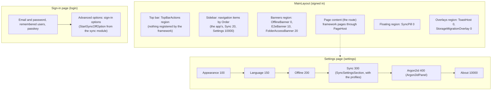
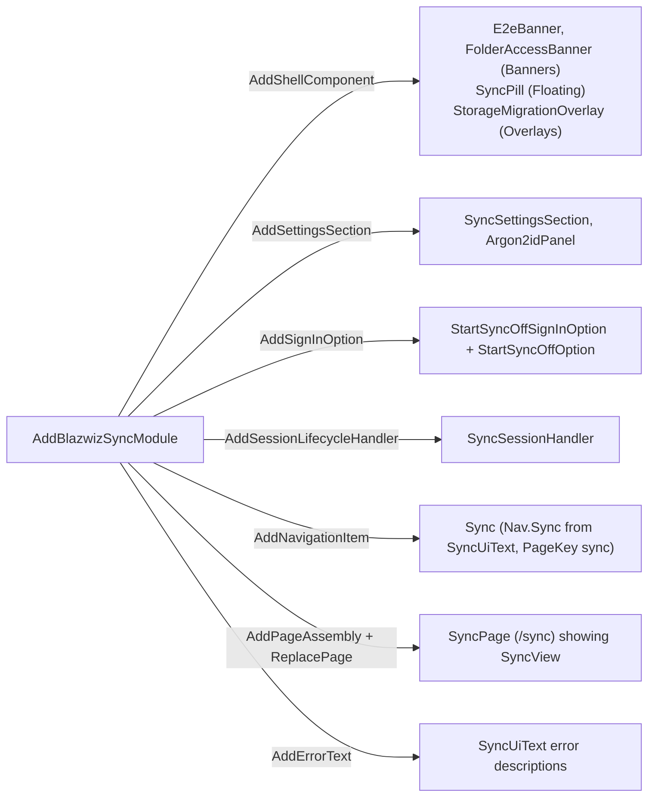
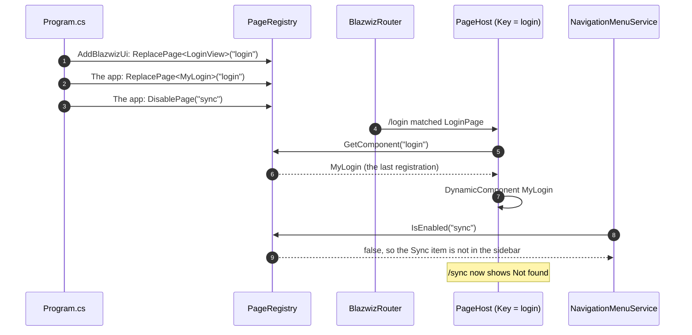
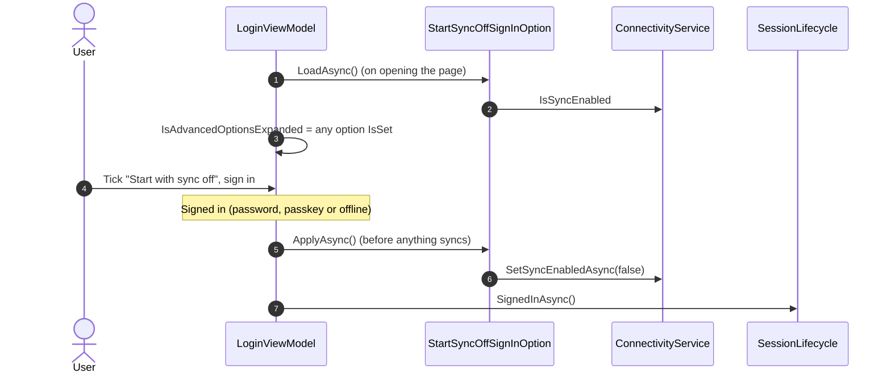

# Extension points

The shell (`src/Devoctomy.Blazwiz.UI`) has no `#if` blocks or references for optional modules. A module (such as
the sync module, `src/Devoctomy.Blazwiz.UI.Sync`) and the app plug into it by registering things in `Program.cs`
or their own `Add*` method. Each extension point is an `IServiceCollection` extension method, mostly in
`src/Devoctomy.Blazwiz.UI/Extensions/ShellServiceCollectionExtensions.cs`, and a registry the shell reads.

| Extension point | Register with | Read by | Shown |
|---|---|---|---|
| Shell regions | `AddShellComponent<TComponent>(ShellRegion, order)` | `ShellRegistry`, `MainLayoutViewModel.Banners` / `TopBarActions` / `Floating` / `Overlays` | In `MainLayout`, in order |
| Settings sections | `AddSettingsSection<TComponent>(order)` | `SettingsSectionRegistry`, `SettingsView` | On the Settings page, in order (`UiServiceCollectionExtensions.SettingsOrder`) |
| Sign-in options | `AddSignInOption<TOption, TComponent>()` | `LoginViewModel` (`ISignInOption`, `SignInOptionRegistration`) | Under "Advanced options" on the sign-in page, expanded when one is set |
| Session lifecycle handlers | `AddSessionLifecycleHandler<THandler>()` (Auth) | `SessionLifecycle` | Not shown: run at sign in, shell loading, session start, signing out, signed out ([session-management.md](session-management.md), diagram 1) |
| Navigation items | `AddNavigationItem(NavigationItem)` | `NavigationMenuService` | In the sidebar, by `Order`. Text from `TextResource` when set. Hidden when its `PageKey` page is disabled |
| Page assemblies | `AddPageAssembly(assembly)` | `BlazwizRouter` (`AdditionalAssemblies`) | A module's `@page` components become routes |
| Page replacement | `ReplacePage<TComponent>(key)`, `DisablePage(key)` | `PageRegistry`, `PageHost` | The framework's pages (`BlazwizPages`: `login`, `forgot-password`, `profile`, `settings`, `sync`) show the last component registered for their key, or Not found when disabled |
| Data migrations | `AddDataMigration<TMigration>()` (Auth) | `DataMigrationRunner`, a lifecycle handler | Not shown: run as the shell loads |
| Text | `AddBlazwizText(text => ...)` (Core) | `OverridingStringLocalizerFactory` | Every text from resources ([text.md](text.md)) |
| Error descriptions | `AddErrorText<TResource>()` (UI) | `ErrorText` | Error codes (`BlazwizException.Code`) described from the module's resources |

## 1. Where things appear in the shell

Items from the sync module are added by `AddBlazwizSyncModule`; everything else by `AddBlazwizUi`. The template's own
sidebar items (Dashboard, Showcase, and the notes example's Notebooks) are added by the app.

## 2. How a module plugs in

The sync module's `AddBlazwizSyncModule` (`src/Devoctomy.Blazwiz.UI.Sync/Extensions/SyncModuleServiceCollectionExtensions.cs`)
uses every kind of extension point:

## 3. Replacing or turning off a framework page

Each framework page is a route component (for example `LoginPage`, `@page "/login"`) holding a `PageHost` with the
page's key. `PageHost` asks `PageRegistry` for the component registered last for that key: the framework registers
its own view first, so the app's registration, made later in `Program.cs`, wins.

## 4. Sign-in options

An option (`ISignInOption`) is a choice made on the sign-in page that takes effect at sign in. Its component is shown
under "Advanced options", which opens by itself when an option is not at its default (`IsSet`), so it is never hidden
while it changes what happens.

The UI tests `SyncTests.GivenSyncOff_WhenSigningOutAndBackIn_ThenAdvancedOptionsShowItAndUntickingTurnsSyncOn` and
`GivenSyncOn_WhenOpeningLogin_ThenAdvancedOptionsCollapsed` cover this.
