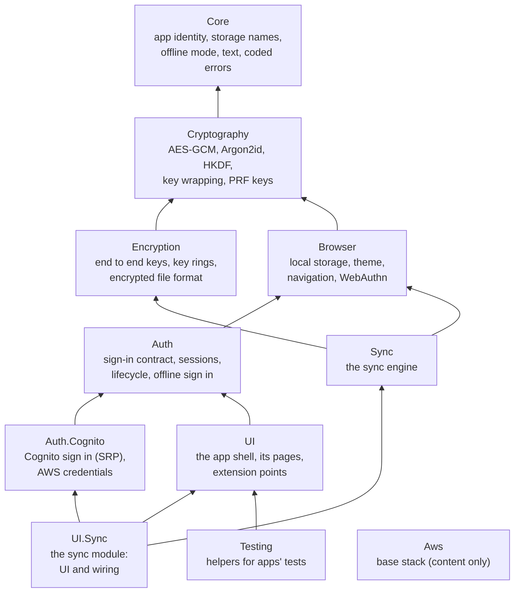
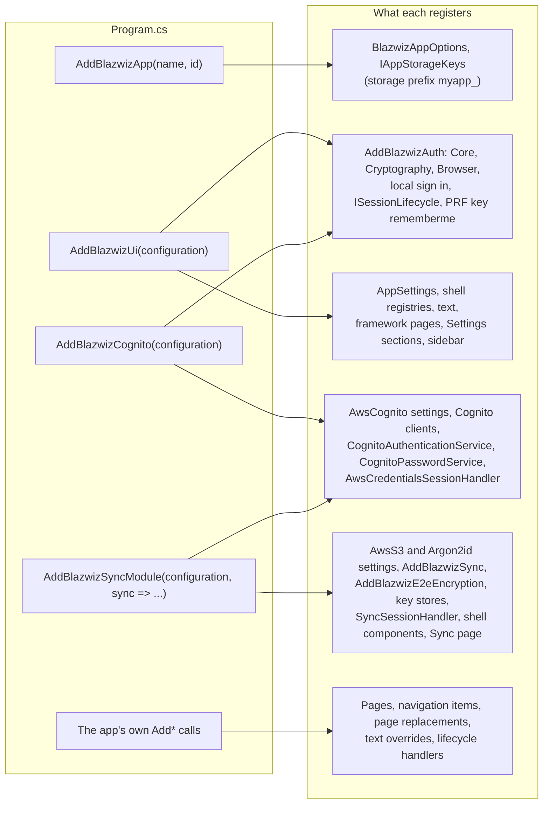
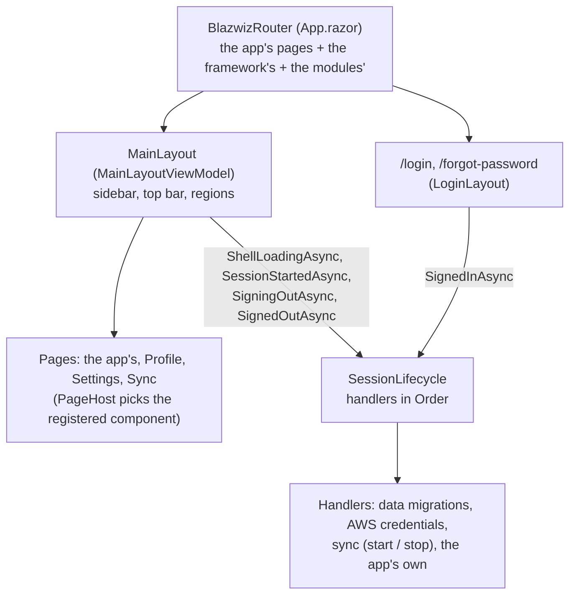

# Overview: the packages and how an app is composed

blazwiz ships as packages (`src/Devoctomy.Blazwiz.<Package>`) and a template app (`template/`) built on them. This doc
shows which package depends on which, and how an app puts them together in `Program.cs`. The other diagrams go into
each part:

| Doc | What it covers |
|---|---|
| [authentication.md](authentication.md) | Signing in with Cognito, AWS credentials, changing and resetting passwords |
| [session-management.md](session-management.md) | Session lifetimes, renewal, expiry, offline mode, and the session lifecycle modules plug into |
| [prf-remember-me.md](prf-remember-me.md) | Passkey sign in, the keys derived from the passkey, and unlocking sync profiles with it |
| [sync.md](sync.md) | How sync runs: starting it, a pass, the decision table, offline, and each profile's keys |
| [sync-framework.md](sync-framework.md) | How an app sets up sync profiles, and what the framework asks of it |
| [extension-points.md](extension-points.md) | Where modules and apps plug into the shell |
| [text.md](text.md) | How text is found, overridden, translated and checked |

## 1. The packages

An arrow points at a package the other depends on. Only direct references are drawn (`Core` and `Cryptography`, used
by almost everything, are reached through the others too). `Devoctomy.Blazwiz.Aws` is content only, the AWS base
stack and its scripts, and depends on nothing.



The engine (`Sync`) knows nothing of Cognito or the UI: `UI.Sync` joins them, giving the engine its S3 client
(`CognitoS3TargetProvider`), its user (`AuthSyncUserContext`) and the keys' store in Secrets Manager
(`SecretsManagerUserKeysStore`). The shell (`UI`) knows nothing of sync: the sync module plugs into its extension
points ([extension-points.md](extension-points.md)).

## 2. How an app is composed

The template's `template/MyApp.Portal/Program.cs`, without the optional parts' markers. Each `Add*` method registers
its package's services, view models and configuration section, and calls the methods of the packages it needs
(`AddBlazwizAuth` from both `AddBlazwizUi` and `AddBlazwizCognito`, which runs once).

```csharp
builder.Services.AddBlazwizApp(AppIdentity.Name, AppIdentity.Id);   // "myapp": names everything kept in the browser
builder.Services.AddBlazwizUi(builder.Configuration);               // the shell and its pages, AppSettings and Text settings
builder.Services.AddBlazwizCognito(builder.Configuration);          // Cognito sign in once AwsCognito is configured
builder.Services.AddBlazwizSyncModule(builder.Configuration, sync => sync
    .UseEmbeddedConfiguration(typeof(Program).Assembly, "sync.json")
    .AddProfilesFromAssemblyContaining<Program>());                 // sync, end to end encryption, the Sync page
builder.Services.AddAppServices();                                  // the app's own services, pages and sidebar items
builder.Services.AddMvvm(options => options.RegisterViewModelsFromAssemblyContaining<DashboardViewModel>());

var host = builder.Build();
await using (var scope = host.Services.CreateAsyncScope())
{
    await scope.ServiceProvider.GetRequiredService<ICultureService>().ApplySavedCultureAsync();   // see text.md
}

await host.RunAsync();
```



| Call | Package | Configuration it reads |
|---|---|---|
| `AddBlazwizApp(name, id)` | Core | None: the name (lower case letters and digits) prefixes every storage name, the id salts the passkey keys |
| `AddBlazwizUi(configuration)` | UI | `AppSettings`, `Text:SupportedCultures`, `Text:PseudoLocalization` |
| `AddBlazwizCognito(configuration)` | Auth.Cognito | `AwsCognito` (region, user pool, app client, identity pool) |
| `AddBlazwizSyncModule(configuration, sync => ...)` | UI.Sync | `AwsS3`, `Argon2id`, and `Sync` through the builder (`UseConfiguration` / `UseEmbeddedConfiguration`) |

`AddBlazwizApp` must come first: the packages read the app's name and id from it, and refuse to start without it
("Call AddBlazwizApp(name, id) before adding the rest of the framework"). Without a user pool configured
(local development), `AddBlazwizCognito` keeps the local sign in, and the sync module keeps the keys in the browser
instead of Secrets Manager.

## 3. At run time



See [session-management.md](session-management.md), diagram 1, for the order things happen in.
