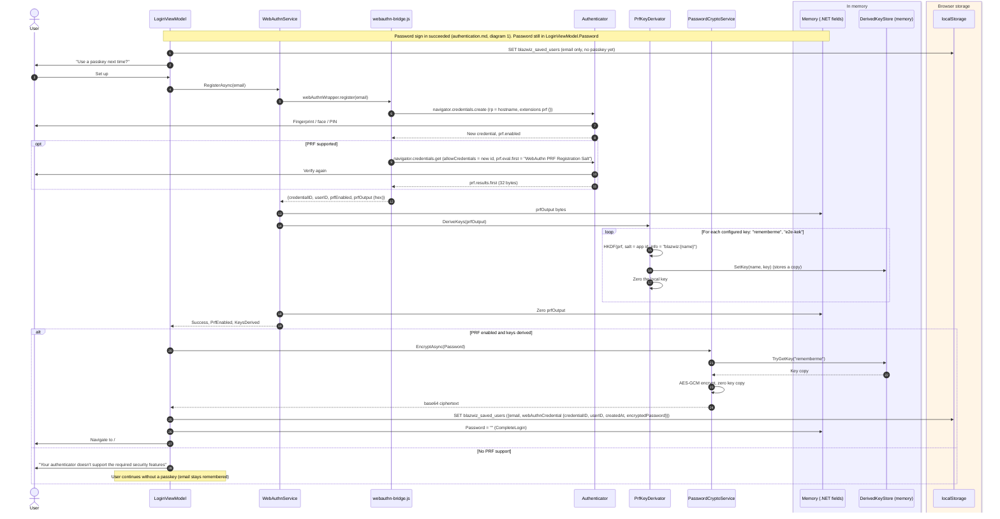
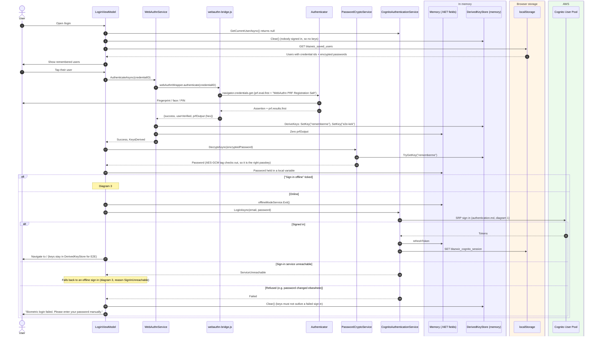
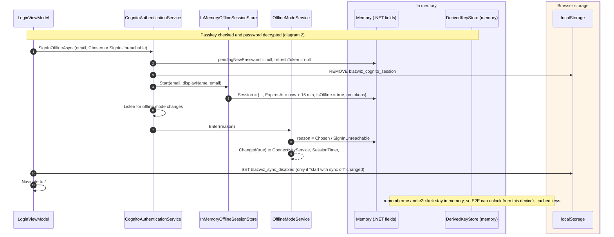
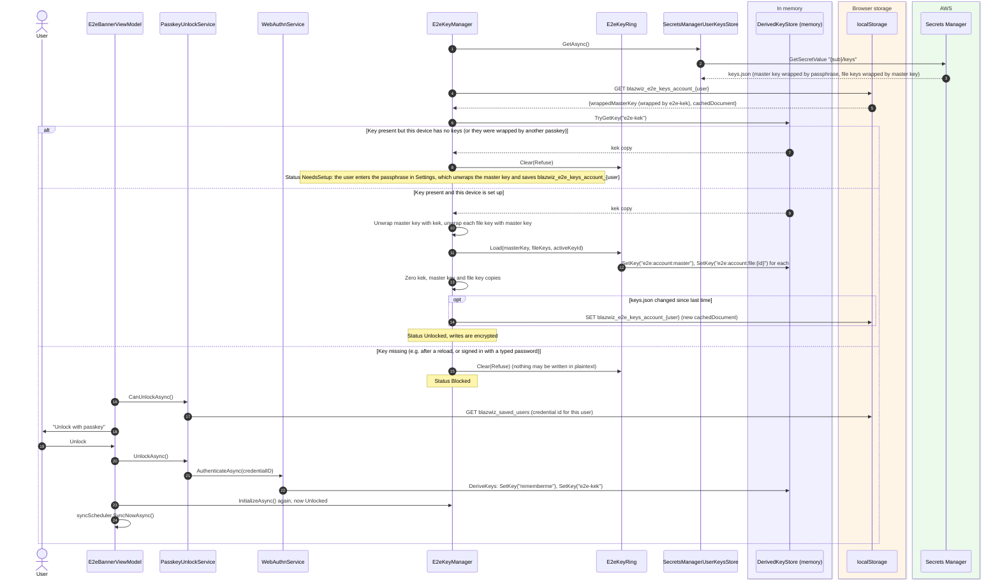
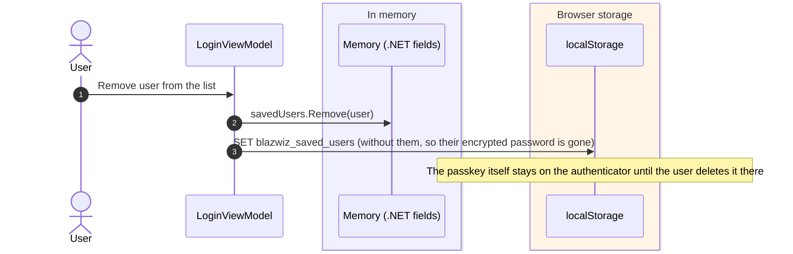

# Passkey (WebAuthn PRF) "remember me"

A remembered user signs in with one touch: their passkey's PRF output derives a key that decrypts the password saved
for them on this device, and that password signs in to Cognito as usual (see [authentication.md](authentication.md)).
The same PRF output derives the key that unlocks end to end encryption on this device.

Main classes:

- `LoginViewModel` (`blazwiz.Portal.Application/ViewModels/LoginViewModel.cs`)
- `WebAuthnService` and `webauthn-bridge.js` (`blazwiz.Portal/Services/WebAuthnService.cs`, `blazwiz.Portal/wwwroot/js/webauthn-bridge.js`), using SimpleWebAuthn
- `PrfKeyDerivator` (`blazwiz.Core/Cryptography/PrfKeyDerivator.cs`): HKDF
- `InMemoryDerivedKeyStore` (`blazwiz.Core/Cryptography/InMemoryDerivedKeyStore.cs`)
- `PasswordCryptoService` (`blazwiz.Portal.Application/Services/PasswordCryptoService.cs`): AES-GCM
- `PasskeyUnlockService` (`blazwiz.Portal.Application/Services/PasskeyUnlockService.cs`)

## Where things are kept

| What | Where | Key / field | Lifetime |
|---|---|---|---|
| PRF output (32 bytes from the authenticator) | Memory, briefly | `WebAuthnService.DeriveKeys` local | Zeroed straight after the keys are derived |
| `rememberme` key (HKDF of the PRF output) | Memory | `InMemoryDerivedKeyStore["rememberme"]` | Until `Clear()`: the login page with nobody signed in, a failed passkey sign in, or a reload |
| `e2e-kek` key (HKDF of the PRF output) | Memory | `InMemoryDerivedKeyStore["e2e-kek"]` | Same as above |
| Saved user: email, credential id, user id, created at, **encrypted password** | localStorage | `blazwiz_saved_users` | Until the user is removed from the list |
| Decrypted password | Memory, briefly | `AttemptWebAuthnLoginAsync` local | Passed to `LoginAsync`, then dropped |
| Passkey private key | Authenticator (platform or roaming) | n/a | Never leaves the authenticator |

The keys are derived as `HKDF(ikm = PRF output, salt = AppIdentity.Id, info = "blazwiz:{key name}")`. The PRF input is
the fixed salt `"WebAuthn PRF Registration Salt"`, so the same passkey always gives the same keys. Changing
`AppIdentity` changes every key, and anything encrypted with the old ones can no longer be decrypted.

There is no relying party server: the WebAuthn challenge is random and generated in the browser, so the assertion
itself proves nothing to anyone. What proves the user is that the PRF output (only available after the authenticator
checks their fingerprint, face or PIN) decrypts the saved password, and that Cognito accepts that password.

## 1. Setting up a passkey after a password sign in

Shown when "Remember me" was ticked and `AppSettings.EnablePortalLoginAuthn` is on.

## 2. One-touch sign in with a remembered passkey

## 3. Offline sign in with a remembered passkey

Only possible with a passkey: decrypting the saved password proves the user on this device, and nothing calls Cognito
or AWS. The session is memory only, lasts 15 minutes, and has no tokens.

## 4. What the PRF keys unlock after sign in: end to end encryption

On startup the shell initialises E2E. The `e2e-kek` derived from the passkey unwraps this device's copy of the
master key. If the page was reloaded the derived keys are gone, so the banner offers "Unlock with passkey".

## 5. Removing a remembered user

