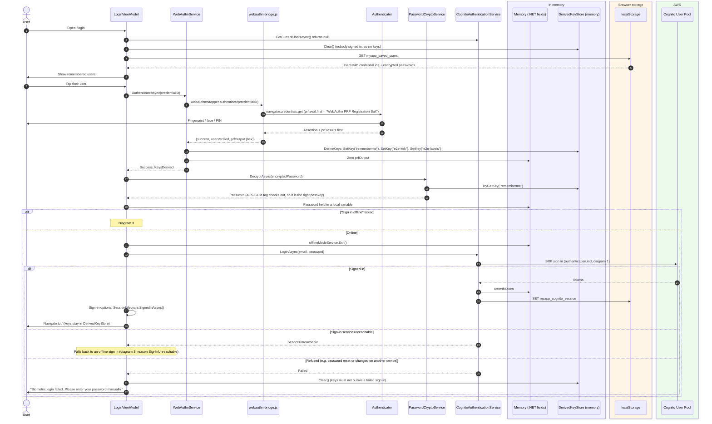
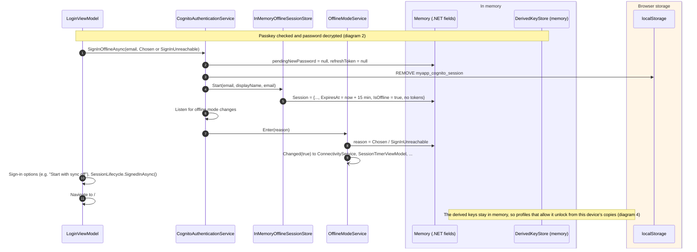

# Passkey (WebAuthn PRF) "remember me"

A remembered user signs in with one touch: their passkey's PRF output derives a key that decrypts the password saved
for them on this device, and that password signs in to Cognito as usual (see [authentication.md](authentication.md)).
The same PRF output derives the keys that unlock sync profiles on this device without their passphrase, where a
profile allows it (diagram 4).

Main classes:

- `LoginViewModel` (`src/Devoctomy.Blazwiz.UI/ViewModels/LoginViewModel.cs`)
- `WebAuthnService` and `webauthn-bridge.js` (`src/Devoctomy.Blazwiz.Browser/Services/WebAuthnService.cs`, `src/Devoctomy.Blazwiz.Browser/wwwroot/js/webauthn-bridge.js`), using SimpleWebAuthn. The package's JS initializer (`wwwroot/Devoctomy.Blazwiz.Browser.lib.module.js`) loads both scripts as Blazor starts
- `PrfKeyDerivator` (`src/Devoctomy.Blazwiz.Cryptography/PrfKeyDerivator.cs`): HKDF, through `BouncyCastleHkdfKeyDerivationService`
- `InMemoryDerivedKeyStore` (`src/Devoctomy.Blazwiz.Cryptography/InMemoryDerivedKeyStore.cs`), behind `IDerivedKeyStore`
- `PasswordCryptoService` (`src/Devoctomy.Blazwiz.Auth/Services/PasswordCryptoService.cs`): AES-GCM
- `ChangePasswordViewModel` (`src/Devoctomy.Blazwiz.UI/ViewModels/ChangePasswordViewModel.cs`): keeps the saved password in step with a password change
- `PasskeyKeysService` (`src/Devoctomy.Blazwiz.UI/Services/PasskeyKeysService.cs`): asks for the passkey again when a feature needs a derived key that is not in memory
- `E2eUnlockPanelViewModel` (`src/Devoctomy.Blazwiz.UI.Sync/ViewModels/`), `SyncProtectedProfileService` (`src/Devoctomy.Blazwiz.Sync/Encryption/`) and `E2eProtectedProfileManager` (`src/Devoctomy.Blazwiz.Encryption/`): unlocking a profile with the passkey

Storage names use the template's app name, `myapp`, which the storage clients add (`IAppStorageKeys`).

## Where things are kept

| What | Where | Key / field | Lifetime |
|---|---|---|---|
| PRF output (32 bytes from the authenticator) | Memory, briefly | `WebAuthnService.DeriveKeys` local | Zeroed straight after the keys are derived |
| `rememberme` key (HKDF of the PRF output), added by Auth | Memory | `InMemoryDerivedKeyStore["rememberme"]` | Until `Clear()`: the login page with nobody signed in, a failed passkey sign in, or a reload |
| `e2e-kek` and `e2e-labels` keys, added by UI.Sync | Memory | `InMemoryDerivedKeyStore["e2e-kek"]`, `["e2e-labels"]` | Same as above |
| Saved user: email, credential id, user id, created at, **encrypted password** | localStorage | `myapp_saved_users` | Until the user is removed from the list, or the password is changed without the key |
| Decrypted password | Memory, briefly | `AttemptWebAuthnLoginAsync` local | Passed to `LoginAsync`, then dropped |
| A profile's master key wrapped by `e2e-kek`, and a copy of its keys document | localStorage | `myapp_e2e_keys_{profile id}_{user}` | Until device unlock is turned off, or the profile is deleted |
| Labels of the profiles the user created, encrypted with `e2e-labels` | localStorage | `myapp_e2e_labels_{user}` | Until the profile is deleted |
| Passkey private key | Authenticator (platform or roaming) | n/a | Never leaves the authenticator |

Each key is `HKDF(ikm = PRF output, salt = app id, info = "{app name}:{key name}")`, with the id and name given to
`AddBlazwizApp` (`AppIdentity` in the template: for example `info = "myapp:rememberme"`). Packages add the keys they
need with `AddBlazwizPrfKeyDerivation(prf => prf.AddKey(...))`. The PRF input is the fixed salt
`"WebAuthn PRF Registration Salt"`, so the same passkey always gives the same keys. Changing the app's name or id
changes every key, and anything encrypted with the old ones can no longer be decrypted.

There is no relying party server: the WebAuthn challenge is random and generated in the browser, so the assertion
itself proves nothing to anyone. What proves the user is that the PRF output (only available after the authenticator
checks their fingerprint, face or PIN) decrypts the saved password, and that Cognito accepts that password.

## 1. Setting up a passkey after a password sign in

Shown when "Remember me" was ticked and `AppSettings.EnablePortalLoginAuthn` is on.


## 2. One-touch sign in with a remembered passkey



## 3. Offline sign in with a remembered passkey

Only possible with a passkey: decrypting the saved password proves the user on this device, and nothing calls Cognito
or AWS. The session is memory only, lasts 15 minutes (`OfflineModeService.SessionLength`), and has no tokens.



## 4. Unlocking a sync profile with the passkey

Every sync profile is end to end encrypted with its own keys, behind its own passphrase (see [sync.md](sync.md)). A
profile whose settings allow it (`E2eProfileSettings.AllowDeviceUnlock`, off by default) can also be unlocked on this
device with the passkey: `e2e-kek` wraps the profile's master key, and the wrapped key is kept with a copy of the
profile's keys document. `E2eUnlockPanel` (UI.Sync), which the app wraps around a profile's pages, offers it once the
user has a passkey on this device (`E2eProfilePresenter`).

```mermaid
sequenceDiagram
    autonumber
    actor User
    participant Panel as E2eUnlockPanelViewModel
    participant PKS as PasskeyKeysService
    participant WA as WebAuthnService
    participant Prof as SyncProtectedProfileService
    participant Mgr as E2eProtectedProfileManager
    participant Ring as E2eKeyRing (the profile's)
    box rgb(240,240,255) In memory
        participant DKS as DerivedKeyStore (memory)
    end
    box rgb(255,245,230) Browser storage
        participant LS as localStorage
    end

    rect rgb(245,245,245)
    Note over User,LS: Turning it on: unlock with the passphrase, with "Unlock with biometrics next time on this device" ticked
    User->>Panel: Passphrase, Unlock
    Panel->>Mgr: UnlockAsync(scope, passphrase) (sync.md, diagram 1)
    Mgr->>Ring: Load(master key, file keys)
    Panel->>PKS: EnsureKeyAsync("e2e-kek")
    alt Not in memory (signed in with a typed password, or reloaded)
        PKS->>LS: GET myapp_saved_users (this user's credential id)
        PKS->>WA: AuthenticateAsync(credentialID) (fingerprint / face / PIN)
        WA->>DKS: DeriveKeys
    end
    Panel->>Prof: EnableDeviceUnlockAsync(scope)
    Prof->>Mgr: EnableDeviceUnlockAsync(scope)
    Mgr->>Ring: TryGetMasterKey
    Mgr->>DKS: TryGetKey("e2e-kek")
    Mgr->>LS: SET myapp_e2e_keys_{profile id}_{user} {wrappedMasterKey = wrap(kek, master key), cachedDocument}
    Mgr->>Mgr: Zero the kek and master key copies
    Note over Panel: Without a passkey here it says so, and the profile is unlocked all the same
    end

    rect rgb(245,245,245)
    Note over User,LS: Unlocking with it, e.g. after a reload or the idle lock
    User->>Panel: "Unlock with biometrics"
    Panel->>Panel: Sync the profile first (SyncProfileAsync, skipped offline)
    Panel->>PKS: EnsureKeyAsync("e2e-kek") (asks for the passkey only if the key is not in memory)
    Panel->>Prof: UnlockWithDeviceAsync(scope)
    Prof->>Mgr: UnlockWithDeviceAsync(scope)
    Mgr->>LS: GET myapp_e2e_keys_{profile id}_{user}
    Mgr->>DKS: TryGetKey("e2e-kek")
    alt Wrapped key and kek present, and the kek unwraps it
        Mgr->>Mgr: Unwrap the master key
        Mgr->>Mgr: Read the keys document from the store when it can be reached; use it if its ETag differs from the copy's
        alt The master key unwraps the document's file keys
            Mgr->>Ring: Load(master key, file keys, active key id)
            Ring->>DKS: SetKey("e2e:{profile id}:master"), SetKey("e2e:{profile id}:file:{key id}")
            Mgr->>Mgr: Zero the kek and master key copies
            Note over Panel: Unlocked: the profile's files read and write
        else The keys were rotated on another device (its passphrase changed)
            Mgr->>LS: SET myapp_e2e_keys_{profile id}_{user} (the new document, the wrapped master key removed)
            Mgr-->>Panel: E2ePassphraseRequiredException (E2e.KeysChanged)
            Panel->>User: Says the passphrase was changed, and asks for the new one
        end
    else No device key, or wrapped by another passkey (registered again)
        Mgr-->>Panel: E2ePassphraseRequiredException
        Panel->>User: Asks for the passphrase
    end
    end
```

Offline, the store cannot be reached and the copy on this device is used, as before. Files edited that way after a
passphrase change elsewhere are written under the retired key, which the keys document keeps, so they stay readable.

`SyncProtectedProfileService.DisableDeviceUnlockAsync` turns it off: it empties the wrapped master key and keeps the
document copy, which still unlocks with the passphrase while offline. Nothing in the UI calls it yet.

## 5. Changing the password keeps the saved one in step

See [authentication.md](authentication.md), diagram 6. After Cognito accepts the new password,
`ChangePasswordViewModel` encrypts it with `rememberme` and replaces this user's saved one. When the key is not in
memory (the user signed in with a typed password, or reloaded) the saved password is removed instead, so the next
sign in asks for the password and offers the passkey again. Resetting a forgotten password (diagram 7 there) does not
change the saved one: the next passkey sign in is refused, and falls back to the typed password (diagram 2).

## 6. Removing a remembered user


