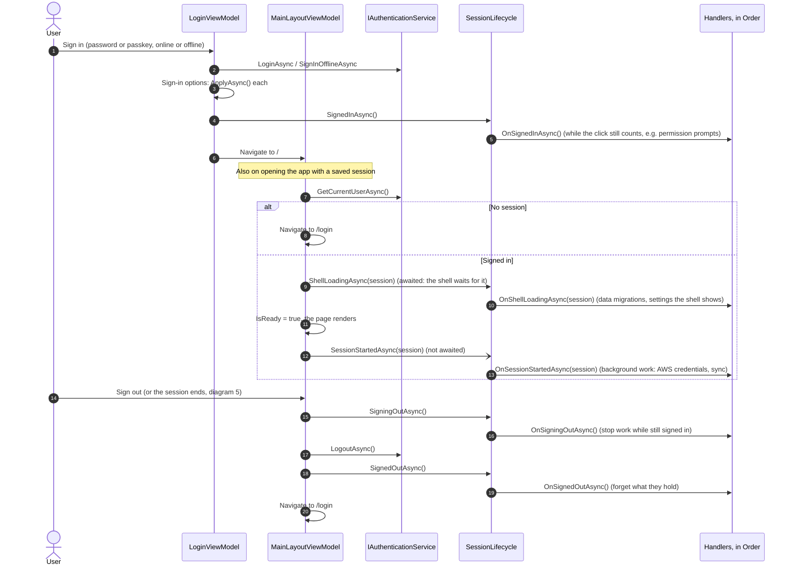
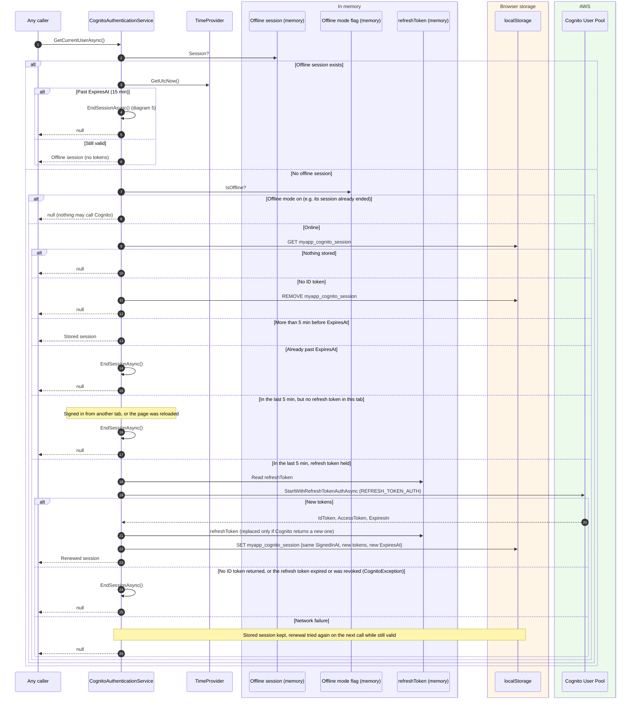
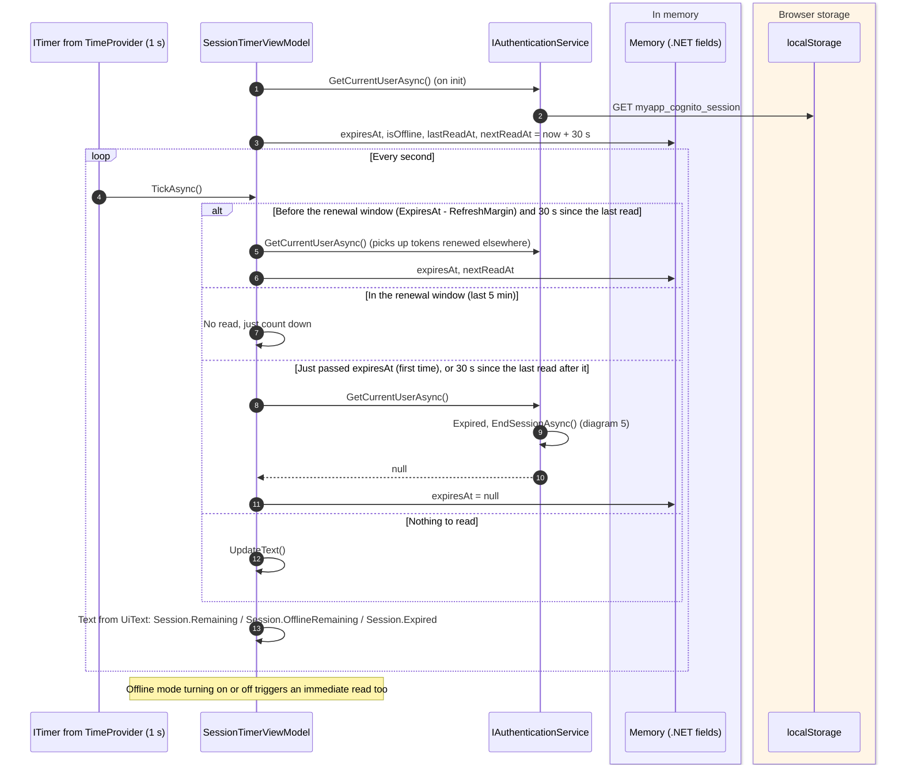
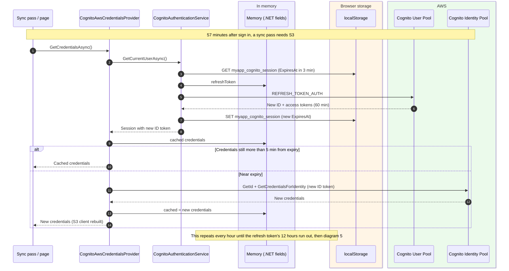
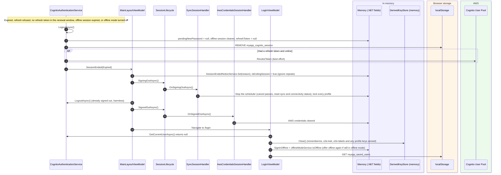
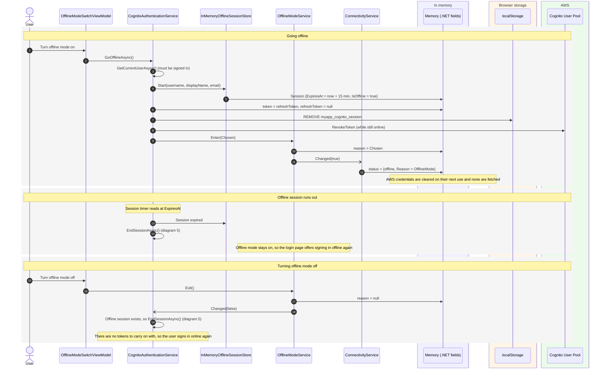

# Session management and expiry

How long a session lasts, when the tokens are renewed, what ends a session, what modules do at sign in and sign out,
and what a reload keeps and loses.

Main classes:

- `CognitoAuthenticationService.GetCurrentUserAsync` (`src/Devoctomy.Blazwiz.Auth.Cognito/Services/CognitoAuthenticationService.cs`): the one place sessions are checked, renewed and ended
- `SessionTimerViewModel` (`src/Devoctomy.Blazwiz.UI/ViewModels/SessionTimerViewModel.cs`): the countdown under the user's name, and the clock that drives renewal. It reads the renewal window from `IAuthenticationService.RefreshMargin`
- `MainLayoutViewModel` (`src/Devoctomy.Blazwiz.UI/ViewModels/MainLayoutViewModel.cs`): starts the session when the shell loads, signs out, and reacts to `SessionEnded`
- `SessionLifecycle` (`src/Devoctomy.Blazwiz.Auth/Sessions/SessionLifecycle.cs`) and the `ISessionLifecycleHandler`s packages and apps add with `AddSessionLifecycleHandler<T>()`
- `OfflineModeService` (`src/Devoctomy.Blazwiz.Core/Offline/OfflineModeService.cs`) and `InMemoryOfflineSessionStore` (`src/Devoctomy.Blazwiz.Auth/Services/InMemoryOfflineSessionStore.cs`)

Storage names use the template's app name, `myapp`, which the storage clients add (`IAppStorageKeys`).

## Lifetimes

| Thing | Lifetime | Set by |
|---|---|---|
| ID and access tokens (`UserSession.ExpiresAt`) | 60 minutes | `IdTokenValidity` / `AccessTokenValidity` in `src/Devoctomy.Blazwiz.Aws/cloudformation/stack.yaml` |
| Renewal window | Last 5 minutes before `ExpiresAt` | `CognitoAuthenticationService.TokenRefreshMargin`, read through `IAuthenticationService.RefreshMargin` |
| Refresh token | 12 hours, and only while this tab stays open | `RefreshTokenValidity`, kept in memory only |
| AWS credentials | As issued by the identity pool (about 1 hour), fetched again 5 minutes before expiry | `CognitoAwsCredentialsProvider.RefreshMargin` |
| Offline session | 15 minutes from going offline, no renewal | `OfflineModeService.SessionLength` |
| Placeholder session (local development) | 8 hours, no renewal (`RefreshMargin` is zero) | `LocalAuthenticationService.SessionDuration` |
| An unlocked sync profile | 15 minutes without a read or write, by default | `E2eProfileSettings.IdleTimeout`, run by `E2eIdleLock` |

A session is only ever renewed **before** it expires. A token that expired while nobody was using the tab is not
brought back to life, even if the refresh token is still valid.

## What survives a reload

| Kept (localStorage, IndexedDB, OPFS, a picked folder) | Lost (memory) |
|---|---|
| `myapp_cognito_session`: the session with ID and access tokens | The refresh token, so the session can no longer be renewed |
| `myapp_saved_users`: remembered users and encrypted passwords | The offline session and offline mode, so a reload always leaves offline mode |
| `myapp_e2e_keys_{profile id}_{user}`, `myapp_e2e_index_{user}`, `myapp_e2e_labels_{user}`: this device's copies of the profiles' keys, their index, and their labels | Every PRF-derived key and every unlocked profile's keys in `IDerivedKeyStore` |
| `myapp_sync_disabled`, `myapp_user_settings` (theme, sidebar), `myapp_culture`, `myapp_data_versions` | AWS credentials and the S3 client |
| The profiles' files, the sync index and the sync event log | Scheduler, connectivity and sync status |

So after a reload the user is still signed in until the ID token reaches its renewal window, then is sent to the
login page (one touch with a passkey). Every sync profile is locked again until its passphrase is entered, or the
passkey is used where the profile allows it ([prf-remember-me.md](prf-remember-me.md), diagram 4).

## 1. The session lifecycle

What modules do at sign in, when the shell loads, and at sign out is not written into the shell: each package adds an
`ISessionLifecycleHandler`, and `SessionLifecycle` calls them in `Order`, one at a time. One that throws is skipped,
so a module failing (for example offline) never stops the others, the sign in or the sign out.

| Handler | Package | Order | What it does |
|---|---|---|---|
| `DataMigrationRunner` | Auth | `int.MinValue` | Shell loading: runs the packages' `IDataMigration`s, recording versions in `myapp_data_versions` |
| `AwsCredentialsSessionHandler` | Auth.Cognito | 0 | Session started: fetches the AWS credentials in the background. Signed out: forgets them |
| `SessionResumeSessionHandler` | Auth | 0 | Session started: checks the session with the sign-in service whenever the app resumes (`SessionResumeMonitor`). Signing out: stops ([user-events.md](user-events.md), diagram 3) |
| `UserEventsSessionHandler` | Events | 0 | Session started: connects the user's event channel, and ends the session when another device signs out everywhere. Signing out: disconnects ([user-events.md](user-events.md)) |
| `SyncSessionHandler` | UI.Sync | 100 | Signed in: asks for persistent storage. Shell loading: reads "sync turned off". Session started: starts sync ([sync.md](sync.md), diagram 1). Signing out: stops sync and locks every profile |
| `DerivedKeySessionHandler` | Auth | `int.MaxValue` | Signed out: wipes every key in `IDerivedKeyStore` (the passkey's `rememberme`, `e2e-kek` and `e2e-labels`), after the modules have locked what they hold, whatever page the app shows next |

Apps add their own handlers the same way.

## 2. How `GetCurrentUserAsync` decides

Everything that needs the user (the shell, the session timer, sync's user context, the AWS credentials provider)
goes through this method, so this is where sessions are renewed and ended.

## 3. The session timer drives renewal

The countdown ticks every second and reads the session again every 30 seconds, but only while reading has no side
effects. In the renewal window it stops reading until the token has expired, so the renewal happens when something
else (a sync pass, a credentials fetch, a page) next asks for the user, or the session ends at expiry. The UI test
`ShellTests.GivenSessionAboutToExpire_WhenLeftIdle_ThenLoginPageIsShownAtExpiry` covers the end.

## 4. Renewal while the app is in use

## 5. A session ends

`EndSessionAsync` signs out and raises `SessionEnded` with the reason (`SessionEndedReason`): `Expired` here, `Revoked`
from the resume check, `SignedOutEverywhere` or `KeysRotated` when another device signed the user out everywhere, with
that device's name ([user-events.md](user-events.md)). The shell hands the reason to the login page
(`SessionEndedNoticeService`), which says why for every reason but `Expired`. `LogoutAsync` on its own (the Sign out
button) and `SignOutEverywhereAsync` do not raise it.

## 6. Offline mode sessions

Turning offline mode on (the switch in Settings, `OfflineSettingsSection`) swaps the online session for a 15 minute
offline one. Signing in offline from the login page does the same without an online session first (see
[prf-remember-me.md](prf-remember-me.md), diagram 3). The UI tests in `SyncTests` (`GivenSignedIn_WhenOfflineModeTurnedOnInSettings_...`,
`GivenOfflineMode_WhenTurnedOff_...`, `GivenOfflineMode_WhenPageReloaded_...`) cover these.

