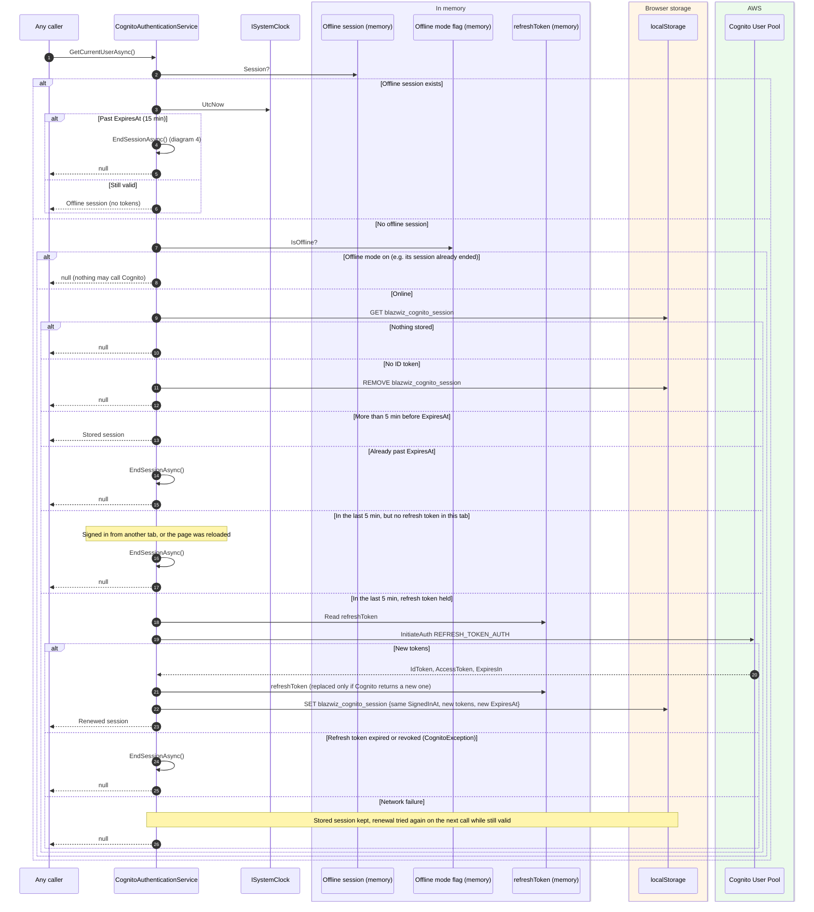
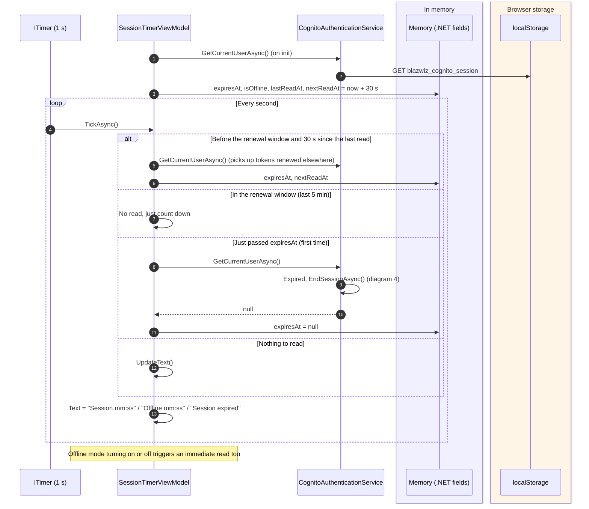
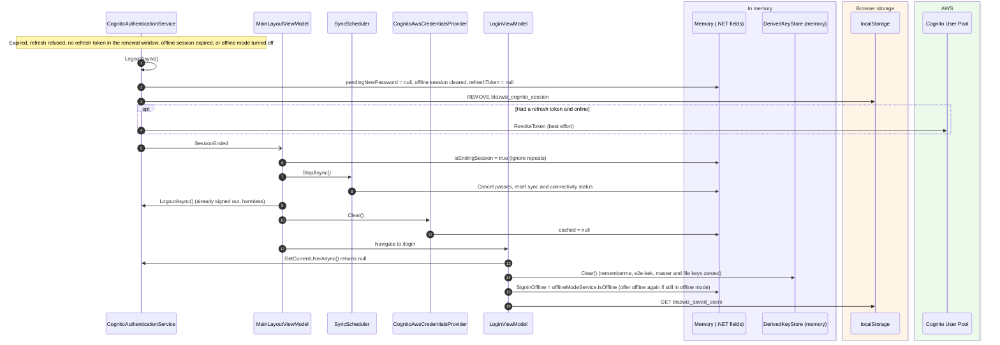

# Session management and expiry

How long a session lasts, when the tokens are renewed, what ends a session, and what a reload keeps and loses.

Main classes:

- `CognitoAuthenticationService.GetCurrentUserAsync` (`blazwiz.Portal.Application/Services/CognitoAuthenticationService.cs`): the one place sessions are checked, renewed and ended
- `SessionTimerViewModel` (`blazwiz.Portal.Application/ViewModels/SessionTimerViewModel.cs`): the countdown under the user's name, and the clock that drives renewal
- `MainLayoutViewModel` (`.../ViewModels/MainLayoutViewModel.cs`): reacts to `SessionEnded`
- `OfflineModeService` (`blazwiz.Core/Offline/OfflineModeService.cs`) and `InMemoryOfflineSessionStore` (`.../Services/InMemoryOfflineSessionStore.cs`)

## Lifetimes

| Thing | Lifetime | Set by |
|---|---|---|
| ID and access tokens (`UserSession.ExpiresAt`) | 60 minutes | `IdTokenValidity` / `AccessTokenValidity` in `cloudformation/stack.yaml` |
| Renewal window | Last 5 minutes before `ExpiresAt` | `CognitoAuthenticationService.RefreshMargin` |
| Refresh token | 12 hours, and only while this tab stays open | `RefreshTokenValidity`, kept in memory only |
| AWS credentials | As issued by the identity pool (about 1 hour), refetched 5 minutes before expiry | `CognitoAwsCredentialsProvider.RefreshMargin` |
| Offline session | 15 minutes from going offline, no renewal | `OfflineModeService.SessionLength` |
| Placeholder session (local development) | 8 hours | `LocalAuthenticationService.SessionDuration` |

A session is only ever renewed **before** it expires. A token that expired while nobody was using the tab is not
brought back to life, even if the refresh token is still valid.

## What survives a reload

| Kept (localStorage, IndexedDB) | Lost (memory) |
|---|---|
| `blazwiz_cognito_session`: the session with ID and access tokens | The refresh token, so the session can no longer be renewed |
| `blazwiz_saved_users`: remembered users and encrypted passwords | The offline session and offline mode, so a reload always leaves offline mode |
| `blazwiz_e2e_keys_{user}`: this device's wrapped master key | Every PRF-derived and E2E key in `DerivedKeyStore` |
| `blazwiz_sync_disabled`, theme, user settings | AWS credentials and the S3 client |
| Notes, sync index, sync event log | Scheduler, connectivity and sync status |

So after a reload the user is still signed in until the ID token reaches its renewal window, then is sent to the
login page (one touch with a passkey). E2E stays locked until they use their passkey again.

## 1. How `GetCurrentUserAsync` decides

Everything that needs the user (the shell, the session timer, sync's user context, the AWS credentials provider)
goes through this method, so this is where sessions are renewed and ended.

## 2. The session timer drives renewal

The countdown ticks every second and re-reads the session every 30 seconds, but only while reading has no side
effects. In the renewal window it stops reading until the token has expired, so the renewal happens when something
else (a sync pass, a credentials fetch, a page) next asks for the user, or the session ends at expiry.

## 3. Renewal while the app is in use

## 4. A session ends

`EndSessionAsync` signs out and raises `SessionEnded`. `LogoutAsync` on its own (the Sign out button) does not raise it.

## 5. Offline mode sessions

Turning offline mode on (the switch in the shell) swaps the online session for a 15 minute offline one. Signing in
offline from the login page does the same without an online session first (see
[prf-remember-me.md](prf-remember-me.md), diagram 3).

