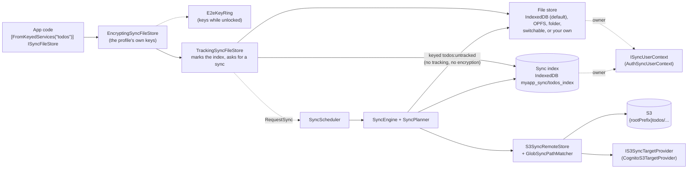
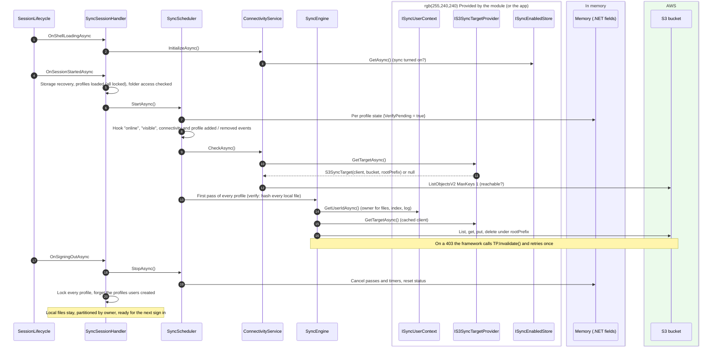
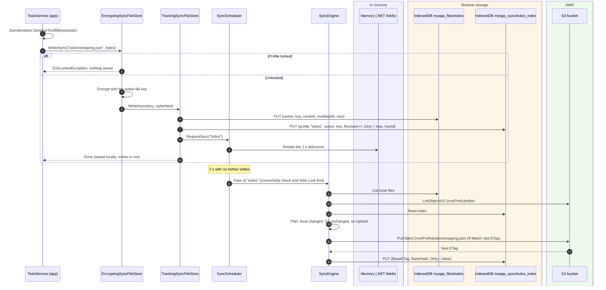
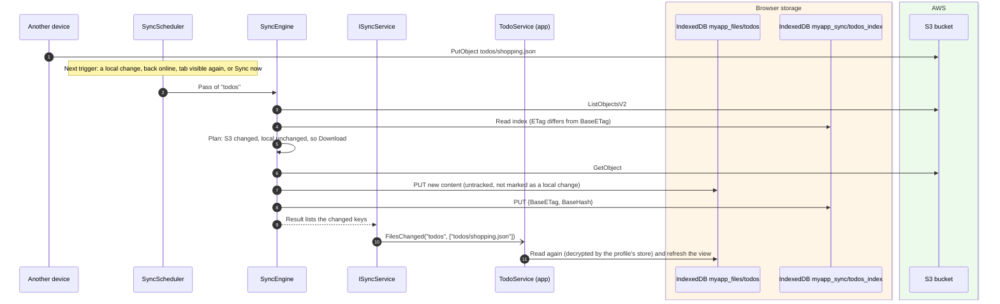

# The sync framework (generic setup)

The Sync package (`src/Devoctomy.Blazwiz.Sync`) is a general-purpose sync engine: it keeps sets of files in the
browser and in step with folders of the user's prefix in an S3 bucket, offline first and end to end encrypted. The
sync module (`src/Devoctomy.Blazwiz.UI.Sync`) adds it to an app with its UI, Cognito credentials and keys. An app
says what to sync as **profiles**, a few lines each.

This doc covers how the framework is put together and how to use it. [sync.md](sync.md) covers how a pass works
inside. The examples use a made-up `todos` profile. Storage names use the template's app name, `myapp`, which the
storage clients add (`IAppStorageKeys`).

## What it syncs

A profile syncs **files**: a key (a path such as `todos/2026/shopping.json`) and its bytes. With the default IndexedDB
store, each file is one record in an object store:

| Field | Example |
|---|---|
| `owner` | The user id from `ISyncUserContext`, so several users can share a browser |
| `key` | `todos/2026/shopping.json` |
| `content` | The bytes (ciphertext: the profile's keys encrypt them before they are stored) |
| `modifiedAt`, `size` | Set on write |

The S3 object is `{rootPrefix}{key}`, where `rootPrefix` is the user's own prefix (`{identityId}/` with Cognito).

So "an IndexedDB table synced to S3" means one file per row: serialise each row (for example to JSON) under its own
key. The engine never looks inside the content, so any format works.

## Minimum setup

In `Program.cs`, after `AddBlazwizApp` and `AddBlazwizUi`, add the sync module with the profiles. A profile can be a
class (found with `AddProfilesFromAssemblyContaining<T>()`), set up inline with `AddProfile(name, ...)`, or come from
configuration (`UseEmbeddedConfiguration`, `UseConfiguration`, see the Sync package's README).

```csharp
// Program.cs: the module, with every SyncProfileDefinition in the app.
builder.Services.AddBlazwizSyncModule(builder.Configuration, sync => sync
    .AddProfilesFromAssemblyContaining<Program>());

// A profile: its id names its keys, so keep it fixed. Everything else has a default.
public sealed class TodosSyncProfile : SyncProfileDefinition
{
    public override string Name => "todos";

    public override void Configure(SyncProfileBuilder profile) => profile
        .UseKeyId("0b6f3c9a-2d4e-4a71-8f5b-c3e9d1a7b245")
        .UseRemote("todos/**/*.json");
}
```

Then, in the app:

```csharp
// Read and write through the profile's store. Every write is encrypted, tracked and synced, nothing else to do.
public class TodoService([FromKeyedServices("todos")] ISyncFileStore files) { ... }
```

The module starts sync when the session starts and stops it at sign out (`SyncSessionHandler`, a session lifecycle
handler), adds the status pill, banners, the Settings section and the Sync page, and asks for the profile's
passphrase. The app does not call the scheduler itself.

`UseRemote` and `UseKeyId` are the only required settings. With just those, the profile uses:

| Thing | Default |
|---|---|
| Files | IndexedDB `myapp_files` / `todos` (the profile name) |
| Sync index | IndexedDB `myapp_sync` / `todos_index` |
| Event log | IndexedDB `myapp_sync` / `events`, kept 30 days, 5000 events per user |
| Debounce after a change | 2 seconds |
| Connectivity check | Reused for 30 s, S3 probe timeout 5 s, rechecks after 30 s, 1 min, 2 min, then every 5 min |
| Conflicts | Newest edit wins (`NewestWinsConflictResolver`) |
| Cross-tab | One pass per profile at a time, using the Web Locks API (`myapp_sync-todos`) |
| Keys | Its own master and file keys, in Secrets Manager as `{sub}/keys/{id}`, behind a passphrase of at least 12 characters (Argon2id) |
| Locking | Locks itself after 15 minutes without a read or write. No passkey unlock |

IndexedDB stores are created the first time they are used, so there is no schema to set up. A new profile can share
an existing database. Profiles must not clash (same name, id, stores or overlapping remote patterns), and no remote
pattern may reach `profiles/`, where the profiles users create are kept: `AddProfile` refuses them at startup.

`AddBlazwizSync` registers all of its own services with `TryAdd`. An app can replace the conflict resolver, hasher and
so on by registering its own first. To use the engine without the module, call `AddBlazwizSync` and provide what the
module otherwise does: `ISyncUserContext`, `IS3SyncTargetProvider`, `ISyncEnabledStore`, and the end to end key
stores and services (`AddBlazwizE2eEncryption`, `IUserKeysStore`, `IE2eLocalKeyStore` and the rest, as
`AddBlazwizSyncModule` registers them).

## Configuration reference

| Builder | Method | What it does |
|---|---|---|
| `SyncBuilder` | `AddProfile(name, ...)`, `AddProfile<T>()`, `AddProfile(definition)` | Adds a profile. Its file store is the keyed service `name` |
| | `AddProfilesFromAssembly(assembly)` / `AddProfilesFromAssemblyContaining<T>()` | Adds every `SyncProfileDefinition` in an assembly, in order of name |
| | `UseConfiguration(section)` / `UseEmbeddedConfiguration(assembly, name)` | The same settings and profiles, from configuration |
| | `UseIndexedDbEventLog(db, store)` / `UseEventLog<T>()` | Where the sync log is kept |
| | `UseEventLogRetention(maxAge, maxEventsPerUser)` | How long the log is kept |
| | `UseChangeDebounce(delay)` | How long after a change a pass runs |
| | `UseConnectivityTimings(t => ...)` | Cache time, probe timeout, recheck backoff |
| | `UseProfileDefaults(s => ...)` | The settings of the profiles users create |
| `SyncProfileBuilder` | `UseRemote(glob, includeEmptyFolders)` | **Required.** Which keys belong to the profile: `*` stays within a folder, `**` crosses folders |
| | `UseKeyId(id)` | **Required.** The profile's id (a GUID), naming its own keys and passphrase |
| | `UseIndexedDbFileStore(db, store)` / `UseFileStore<T>()` | Where the files are kept |
| | `UseFileStores(s => s.AddIndexedDb(...).AddOpfs(...).AddLocalFolder().UseDefault(...))` | Lets the user pick the storage on each device and move between them |
| | `UseIndexedDbIndexStore(db, store)` / `UseIndexStore<T>()` | Where the sync index is kept |
| | `UseProfileSettings(s => ...)` | When it locks itself, passkey unlock, passphrase rules, Argon2id costs |
| | `UseDisplayText(key, resourceType)` | The name it is shown by, from resources |

For comparison, the template's `files` profile (`template/MyApp.Portal/Sync/FilesSyncProfile.cs`) lets the user pick
where its files are kept, and the template's `sync.json` sets the debounce and the event log:

```csharp
public sealed class FilesSyncProfile : SyncProfileDefinition
{
    public const string KeyId = "7c9e2a4b-1f3d-4e8a-b6c5-2d9f0e1a3b57";

    public override string Name => "files";

    public override void Configure(SyncProfileBuilder profile) => profile
        .UseIndexedDbIndexStore(database: "sync", store: "files_index")
        .UseFileStores(stores => stores
            .AddIndexedDb(database: "files", store: "files")
            .AddOpfs(root: "files")
            .AddLocalFolder()
            .UseDefault(SyncStorageKind.IndexedDb))
        .UseRemote("files/**/*")
        .UseKeyId(KeyId)
        .UseDisplayText("Sync.Profile.Files", typeof(SyncUiText));
}
```

## 1. What one profile is made of

`SyncProfileRegistry` builds this for each profile, the ones set up in code and the ones users create. The app only
ever sees the store at the top left.



The engine works on the **untracked** store, so its own downloads don't mark files as changed and it moves ciphertext
as it is, whether the profile is unlocked or not.

## 2. What the module does and what the framework asks of it

The services in the red box are what the sync module (UI.Sync) provides; an app using `AddBlazwizSync` alone provides
them itself.



## 3. Writing a record



## 4. A change from another device



The framework doesn't poll S3 on a timer. Remote changes arrive on the next trigger: a local change, coming back
online, the tab becoming visible, or `SyncNowAsync()`.

## 5. Status and UI hooks

| Service | Use it for |
|---|---|
| `ISyncService.Status` / `StatusChanged` | State (idle, syncing, error), last synced time, pending count, last error, worked out from every profile |
| `ISyncService.FilesChanged` | Reloading views after downloads or remote deletes |
| `IConnectivityService.Status` / `StatusChanged` | Online, or why not (offline mode, sync off, no network, no credentials, unreachable) |
| `IConnectivityService.SetSyncEnabledAsync(bool)` | A "sync on/off" switch, remembered through `ISyncEnabledStore` |
| `ISyncScheduler.SyncNowAsync()` / `SyncProfileAsync(name)` | A "Sync now" button, or one profile before it is opened |
| `ISyncEventLog` | A per-file history ("uploaded", "conflict resolved, kept the newer remote version") |
| `ISyncProtectedProfileService` | The profiles and their state (set up, labels), creating and deleting profiles, passkey unlock |
| `IE2eProtectedProfileManager` | Unlocking with a passphrase, locking, `LockStateChanged` |
| `E2eUnlockPanel` (UI.Sync component) | Wrap a profile's pages: shows them once it is unlocked, and asks for the passphrase until then |
| `IOfflineModeService` | App-wide offline mode: no network calls at all |
