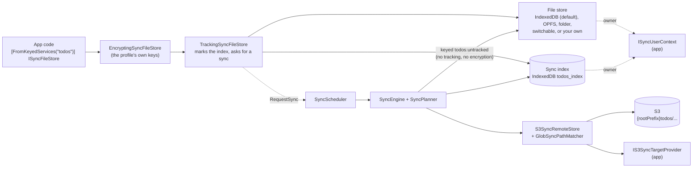
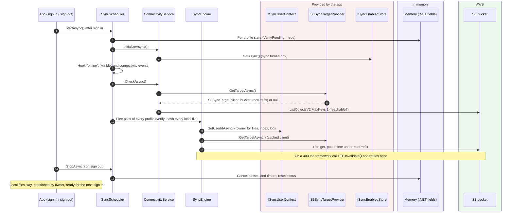
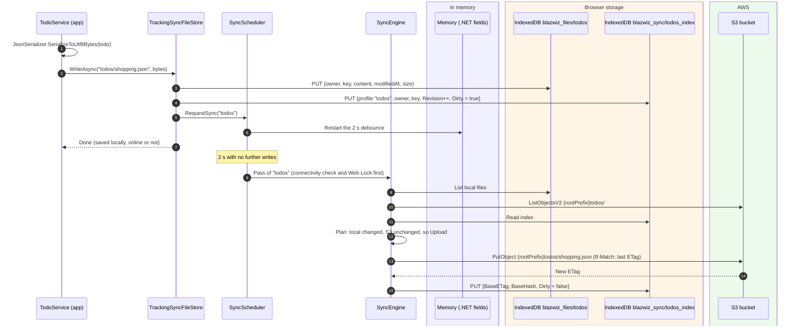
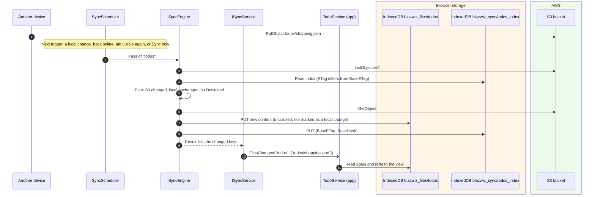

# The sync framework (generic setup)

`blazwiz.Core` contains a general-purpose sync engine: it keeps a set of files in the browser and keeps them in step
with a prefix in an S3 bucket, offline first. Notes are one user of it (a profile called `notes`). Any app can add its
own profiles with a few lines of configuration.

This doc covers how the framework is put together and how to use it. [sync.md](sync.md) covers how a pass works inside
and how notes are configured.

## What it syncs

A profile syncs **files**: a key (a path such as `todos/2026/shopping.json`) and its bytes. With the default IndexedDB
store, each file is one record in an object store:

| Field | Example |
|---|---|
| `owner` | The user id from `ISyncUserContext`, so several users can share a browser |
| `key` | `todos/2026/shopping.json` |
| `content` | The bytes |
| `modifiedAt`, `size` | Set on write |

The S3 object is `{rootPrefix}{key}`, where `rootPrefix` is the user's own prefix (for example `{identityId}/`).

So "an IndexedDB table synced to S3" means one file per row: serialise each row (for example to JSON) under its own
key. The engine never looks inside the content, so any format works.

## Minimum setup

The app provides three small services, then adds a profile:

```csharp
// 1. Who is signed in. Local files, the index and the log are partitioned by this id.
services.AddScoped<ISyncUserContext, MyUserContext>();

// 2. The S3 client, bucket and the user's root prefix (null when signed out).
services.AddScoped<IS3SyncTargetProvider, MyS3TargetProvider>();

// 3. Where "sync turned off" is remembered (e.g. localStorage).
services.AddScoped<ISyncEnabledStore, MySyncEnabledStore>();

// 4. The profile: everything else has a default.
services.AddBlazwizSync(sync => sync
    .AddProfile("todos", profile => profile
        .UseRemote("todos/**/*.json")));
```

Then, in the app:

```csharp
// Read and write through the profile's store. Every write is tracked and synced, nothing else to do.
public class TodoService([FromKeyedServices("todos")] ISyncFileStore files) { ... }

// Start after sign in (or app start with a saved session), stop on sign out.
await syncScheduler.StartAsync();
await syncScheduler.StopAsync();
```

`UseRemote` is the only required setting. With just that, the profile uses:

| Thing | Default |
|---|---|
| Files | IndexedDB `blazwiz_files` / `todos` (the profile name) |
| Sync index | IndexedDB `blazwiz_sync` / `todos_index` |
| Event log | IndexedDB `blazwiz_sync` / `events`, kept 30 days, 5000 events per user |
| Debounce after a change | 2 seconds |
| Connectivity check | Reused for 30 s, S3 probe timeout 5 s, rechecks after 30 s, 1 min, 2 min, then every 5 min |
| Conflicts | Newest edit wins (`NewestWinsConflictResolver`) |
| Cross-tab | One pass per profile at a time, using the Web Locks API |

IndexedDB stores are created the first time they are used, so there is no schema to set up. A new profile can share
an existing database.

`AddBlazwizSync` registers all of its own services with `TryAdd`. An app can replace the conflict resolver, clock,
hasher and so on by registering its own first.

## Configuration reference

| Builder | Method | What it does |
|---|---|---|
| `SyncBuilder` | `AddProfile(name, ...)` | Adds a profile. Its file store is the keyed service `name` |
| | `UseIndexedDbEventLog(db, store)` / `UseEventLog<T>()` | Where the sync log is kept |
| | `UseEventLogRetention(maxAge, maxEventsPerUser)` | How long the log is kept |
| | `UseChangeDebounce(delay)` | How long after a change a pass runs |
| | `UseConnectivityTimings(t => ...)` | Cache time, probe timeout, recheck backoff |
| `SyncProfileBuilder` | `UseRemote(glob, includeEmptyFolders)` | **Required.** Which keys belong to the profile: `*` stays within a folder, `**` crosses folders |
| | `UseIndexedDbFileStore(db, store)` / `UseFileStore<T>()` | Where the files are kept |
| | `UseFileStores(s => s.AddIndexedDb(...).AddOpfs(...).AddLocalFolder().UseDefault(...))` | Lets the user pick the storage on each device and move between them |
| | `UseIndexedDbIndexStore(db, store)` / `UseIndexStore<T>()` | Where the sync index is kept |
| | `UseKeyId(id)` | **Required.** The profile's id (a GUID), naming its own keys and passphrase. Every profile is end-to-end encrypted, which needs `AddBlazwizE2eEncryption()` |
| | `UseProfileSettings(s => ...)` | When it locks itself, passkey unlock, passphrase rules, Argon2id costs |
| | `UseDisplayText(key, resourceType)` | The name it is shown by, from resources |

For comparison, notes uses most of the options:

```csharp
services.AddBlazwizSync(sync => sync
    .UseIndexedDbEventLog(database: "blazwiz_sync", store: "events")
    .UseEventLogRetention(maxAge: TimeSpan.FromDays(30), maxEventsPerUser: 5000)
    .UseChangeDebounce(TimeSpan.FromSeconds(2))
    .AddProfile("notes", profile => profile
        .UseIndexedDbIndexStore(database: "blazwiz_sync", store: "notes_index")
        .UseFileStores(stores => stores
            .AddIndexedDb(database: "blazwiz_notes", store: "files")
            .AddOpfs(root: "blazwiz_notes")
            .AddLocalFolder()
            .UseDefault(SyncStorageKind.IndexedDb))
        .UseRemote("notes/**/*.md", includeEmptyFolders: true)
        .UseKeyId("3f2b8c1e-6d4a-4f7b-9c2e-8a1d5b7e9f40")));
```

## 1. What one profile is made of

`AddBlazwizSync` builds this for each profile. The app only ever sees the store at the top left.



The engine works on the **untracked** store, so its own downloads don't mark files as changed and it moves ciphertext
as it is.

## 2. What the app does and what the framework asks of it



## 3. Writing a record



## 4. A change from another device



The framework doesn't poll S3 on a timer. Remote changes arrive on the next trigger: a local change, coming back
online, the tab becoming visible, or `SyncNowAsync()`.

## 5. Status and UI hooks

| Service | Use it for |
|---|---|
| `ISyncService.Status` / `StatusChanged` | State (idle, syncing, error), last synced time, pending count, last error |
| `ISyncService.FilesChanged` | Reloading views after downloads or remote deletes |
| `IConnectivityService.Status` / `StatusChanged` | Online, or why not (offline mode, sync off, no network, no credentials, unreachable) |
| `IConnectivityService.SetSyncEnabledAsync(bool)` | A "sync on/off" switch, remembered through `ISyncEnabledStore` |
| `ISyncScheduler.SyncNowAsync()` | A "Sync now" button |
| `ISyncEventLog` | A per-file history ("uploaded", "conflict resolved, kept the newer remote version") |
| `IOfflineModeService` | App-wide offline mode: no network calls at all |
