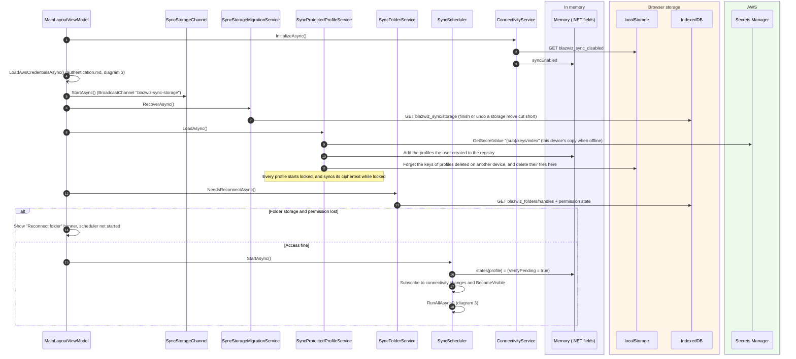
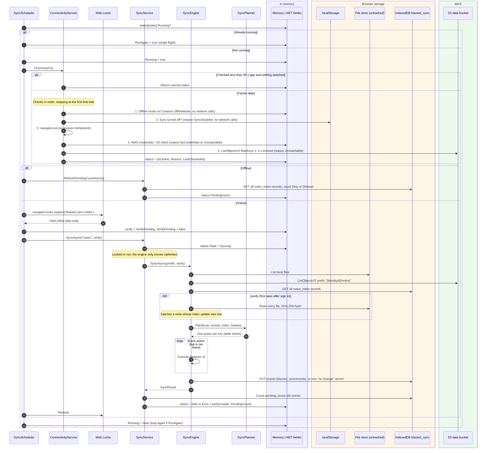
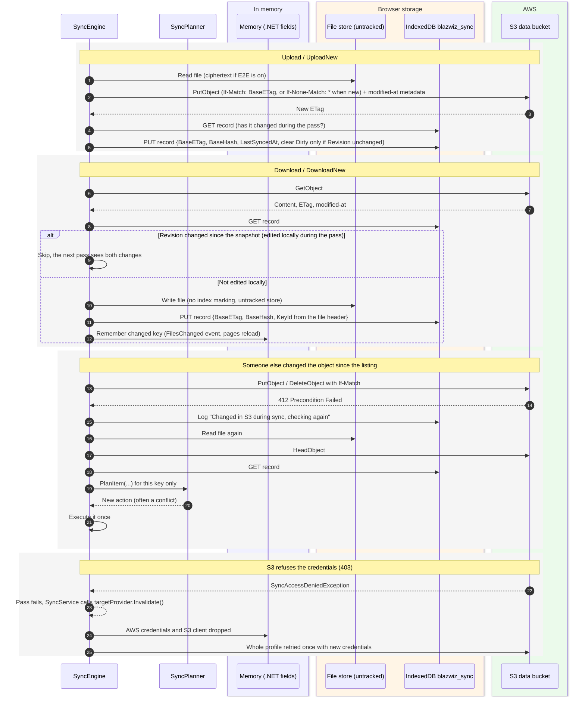
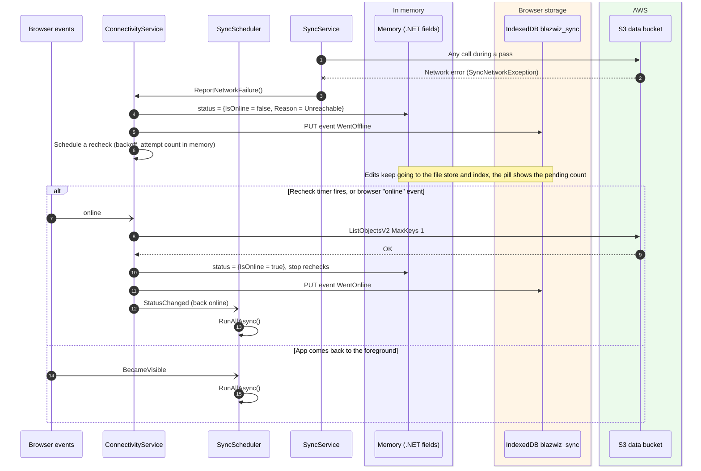
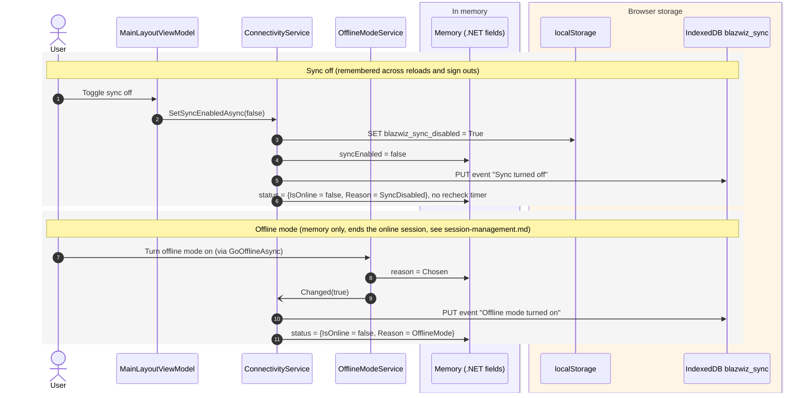

# Sync

Notes are plain markdown files kept on the device and synced with the user's prefix in the S3 data bucket. Every
change is recorded locally first, so the app works the same offline. A pass compares three things per file (the local
file, the S3 object, and the index record from the last sync) and decides what to do.

Main classes (all under `blazwiz.Core/Sync/` unless noted):

- `SyncScheduler`: when passes run (start, change debounce, back online, back to foreground, Sync now)
- `ConnectivityService` (`Connectivity/`): whether a pass may touch the network
- `SyncService`: runs passes per profile, gates, status, pending count
- `SyncEngine` + `SyncPlanner`: one pass, the decision table
- `TrackingSyncFileStore`: marks the index when the app writes a file
- `EncryptingSyncFileStore` (`Encryption/`): plaintext in the app, ciphertext on disk and in S3, with the profile's
  own keys
- `SyncProtectedProfileService` (`Encryption/`) and `E2eProtectedProfileManager` (Encryption package): each profile's
  keys and passphrase, the profiles the user creates, unlocking and locking
- `S3SyncRemoteStore` (`S3/`), with `CognitoS3TargetProvider` (`blazwiz.Portal.Application/Services/`) for the client
- `WebLockSyncLockService`: one pass per profile across all tabs

Wiring is in `blazwiz.Core/Extensions/SyncServiceCollectionExtensions.cs` and the `notes` profile is configured in
`blazwiz.Portal.Application/Extensions/ServiceCollectionExtensions.cs`.

## Where things are kept

| What | Where | Key / name | Notes |
|---|---|---|---|
| Note files | IndexedDB **or** OPFS **or** a folder the user picked (per device, Settings) | `blazwiz_notes` / `files`, OPFS `blazwiz_notes/`, or the folder | Always ciphertext, with the profile's own keys |
| Folder handle (for the picked folder) | IndexedDB | `blazwiz_folders` / `handles` | Browser asks again for permission after a restart |
| Which storage is in use, per user | IndexedDB | `blazwiz_sync` / `storage` | Default IndexedDB |
| Sync index: per file `BaseETag`, `BaseHash`, `Dirty`, `Deleted`, `Revision`, `KeyId` | IndexedDB | `blazwiz_sync` / `notes_index` | Keyed by profile + owner + file key |
| Sync event log | IndexedDB | `blazwiz_sync` / `events` | 30 days, 5000 events per user |
| "Sync turned off" flag | localStorage | `blazwiz_sync_disabled` | Survives reloads and sign outs |
| Scheduler state per profile (`Running`, `RunAgain`, `VerifyPending`, debounce timer) | Memory | `SyncScheduler.states` | Reset on start |
| Connectivity status (online, reason, last checked) | Memory | `ConnectivityService.status` | Cached 30 seconds |
| Sync status (state, last error, pending count, last synced) | Memory | `SyncService.status` | Shown in the status pill |
| AWS credentials and S3 client | Memory | see [authentication.md](authentication.md) | |
| E2E master and file keys, per profile | Memory | `DerivedKeyStore` via `E2eKeyRings` (one ring per profile) | Only while the profile is unlocked |
| Each profile's keys document | Secrets Manager (localStorage without Cognito) | `{sub}/keys/{profile id}` | Wrapped by its passphrase (Argon2id) |
| Index of the user's profiles | Secrets Manager (localStorage without Cognito) | `{sub}/keys/index` | Ids only; this device keeps a copy |
| This device's copy of each keys document | localStorage | `e2e_keys_{profile id}_{user}` | For unlocking offline, and with the passkey where allowed |
| Remote copy | S3 | `{identityId}/notes/**/*.md` | `x-amz-meta-modified-at` holds the edit time |

### The file store stack

The app and the sync engine see different stacks over the same files:

| Used by | Stack (outer to inner) |
|---|---|
| App code (`NoteService`), keyed `notes` | `EncryptingSyncFileStore` → `TrackingSyncFileStore` → `SwitchableSyncFileStore` → IndexedDB / OPFS / folder |
| Sync engine (`SyncProfile.FileStore`), keyed `notes:untracked` | `SwitchableSyncFileStore` → IndexedDB / OPFS / folder |

So the app reads and writes plaintext and every write marks the index, while the engine moves ciphertext between disk
and S3 without marking anything dirty.

## 1. Starting sync after sign in



## 2. The app saves a note

```mermaid
sequenceDiagram
    autonumber
    participant Notes as NoteService
    participant EncFS as EncryptingSyncFileStore
    participant Ring as E2eKeyRing
    participant Track as TrackingSyncFileStore
    participant Sched as SyncScheduler
    box rgb(240,240,255) In memory
        participant Mem as Memory (.NET fields)
    end
    box rgb(255,245,230) Browser storage
        participant Files as File store (IndexedDB / OPFS / folder)
        participant IDB as IndexedDB blazwiz_sync
    end

    Notes->>EncFS: WriteAsync("notes/foo.md", plaintext)
    EncFS->>Ring: ActiveKeyId? (the notes profile's ring)
    alt Unlocked
        Ring->>Mem: TryGetFileKey(activeKeyId) from DerivedKeyStore
        EncFS->>EncFS: Encrypt with the file key, binding the profile id and path; reset the idle timer
    else Locked
        EncFS-->>Notes: E2eLockedException, nothing saved
    end
    EncFS->>Track: WriteAsync(key, bytes)
    Track->>Files: Write file
    Track->>IDB: GET notes_index record (profile, owner, key)
    Track->>IDB: PUT record {Revision++, Dirty = true, Deleted = false, KeyId, Encrypted}
    Track->>Sched: RequestSync("notes")
    Sched->>Mem: Cancel previous debounce, start a 2 s debounce
    Note over Sched: Each save restarts the timer, so a burst of typing gives one pass
    Sched->>Sched: After 2 s: RunProfileAsync("notes") (diagram 3)
```

Deleting works the same way, but leaves a tombstone: `Dirty = false`, `Deleted = true`, `DeletedAt = now`.

## 3. A sync pass



### Planner decision table

`changed locally` = `Dirty`, `Deleted`, or (on a verify pass) the file's hash differs from `BaseHash`.
`changed remotely` = the S3 ETag differs from `BaseETag`.

| Local file | S3 object | Index record | Action |
|---|---|---|---|
| none | none | none or live | `None` / `DropRecord` |
| none | none | tombstone | `DropRecord` |
| none | exists | tombstone, ETag = base | `DeleteRemote` |
| none | exists | tombstone, ETag ≠ base | Conflict `DeleteEdit` |
| none | exists | none or no base | `DownloadNew` |
| none | exists | has base | `Download` (local copy went missing) |
| exists | none | no base | `UploadNew` |
| exists | exists | no base | `CompareContent` |
| exists | none | has base, not changed locally | `DeleteLocal` |
| exists | none | has base, changed locally | Conflict `EditDelete` |
| exists | exists | not changed either side | `None` |
| exists | exists | changed locally only | `Upload` |
| exists | exists | changed remotely only | `Download` |
| exists | exists | changed both sides | Conflict `EditEdit` |

Conflicts go to `NewestWinsConflictResolver`: the newer edit wins, comparing the local modified time (or `DeletedAt`)
with the remote `x-amz-meta-modified-at`.

## 4. Executing actions: upload, download, retry on a race

Every S3 write is conditional, so a change made by another device between the listing and the write is never
overwritten.



Any other per-file failure is counted and logged, and the pass carries on with the next file. A network failure stops
the pass and tells `ConnectivityService`, which marks the app offline.

## 5. Going offline and coming back



## 6. Sync turned off and offline mode

Both stop all network calls. They differ in what they mean and how long they last.


