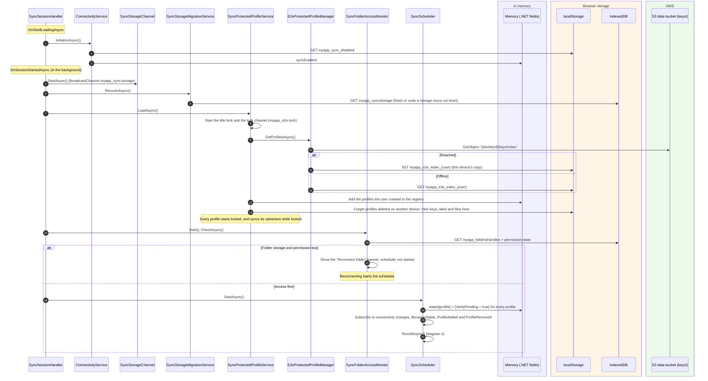
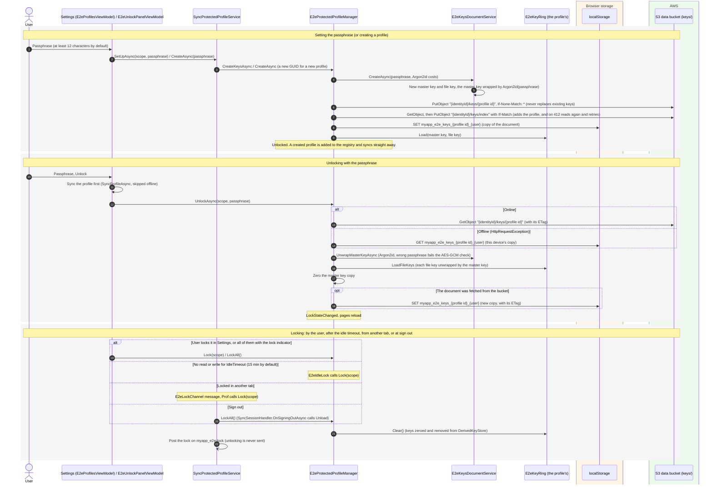
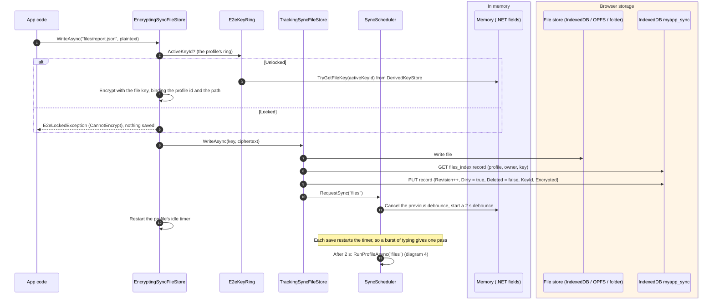
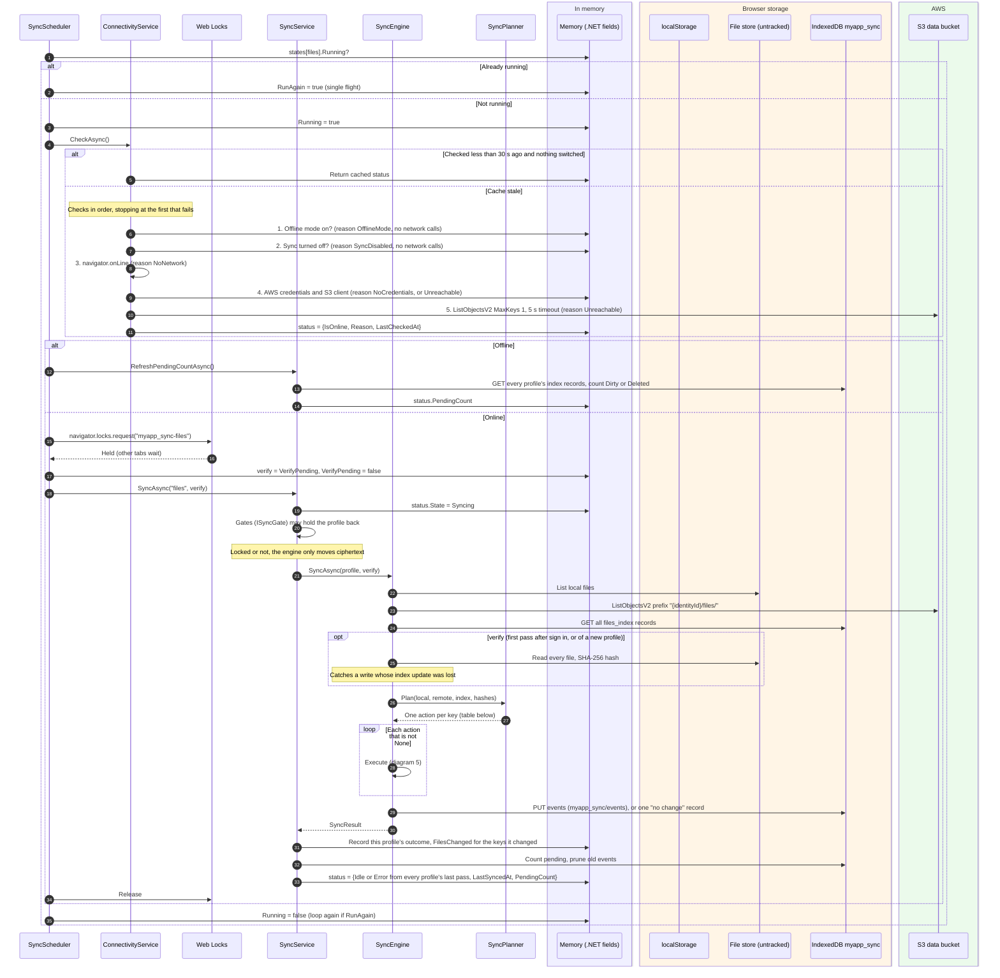
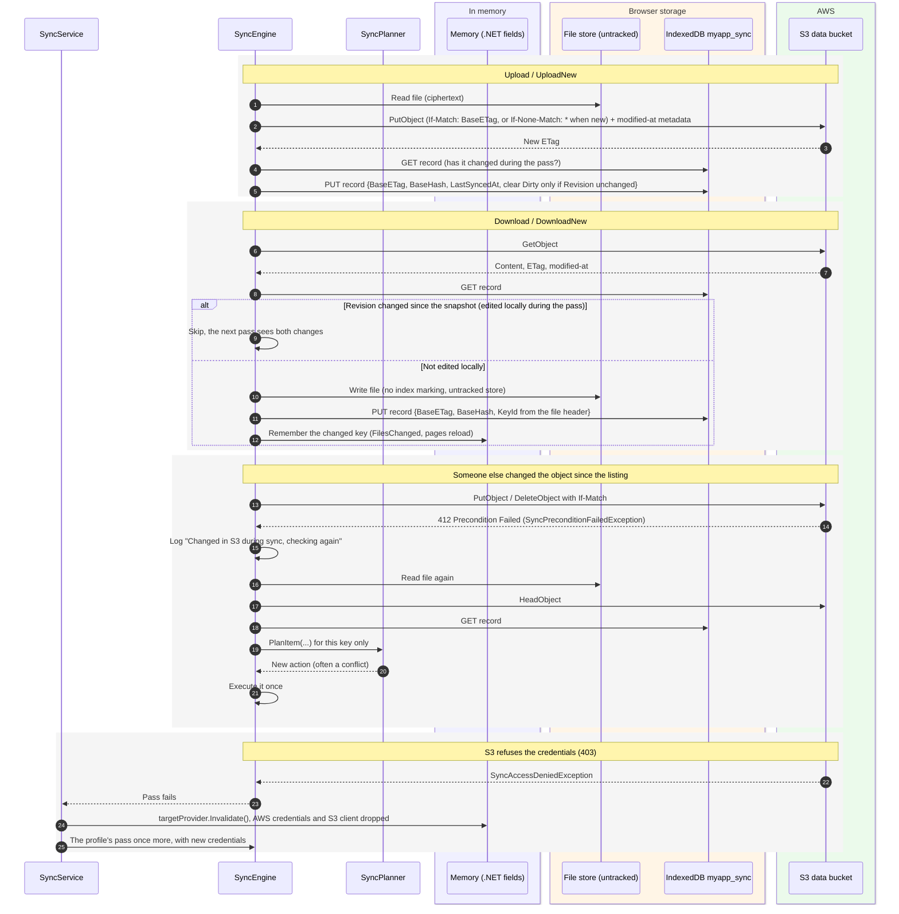
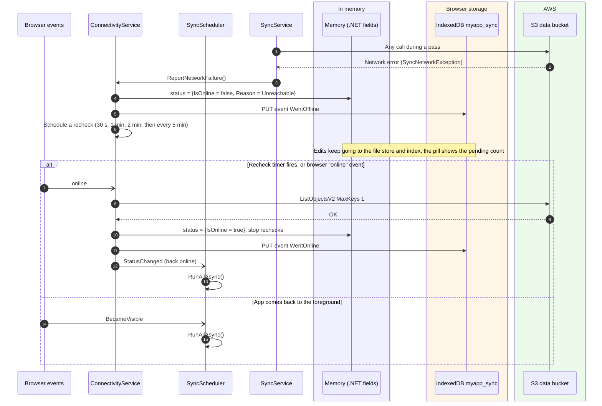
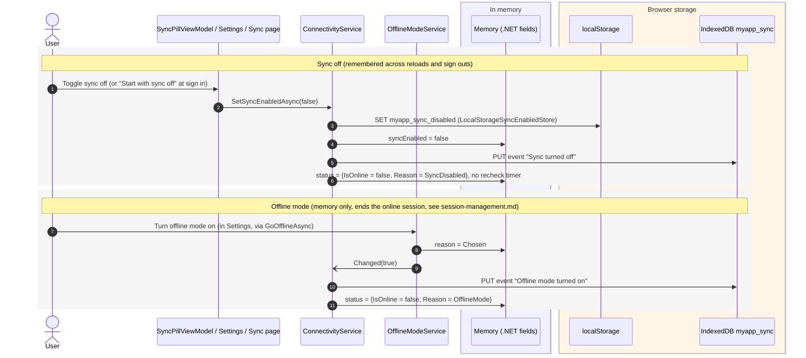
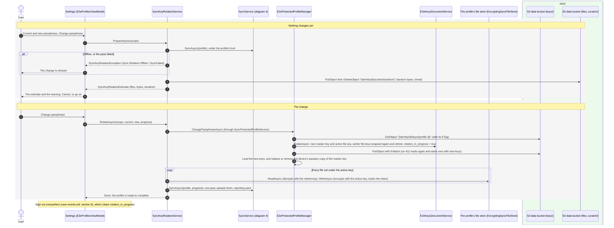

# Sync

A sync profile is a set of files kept on the device and synced with a folder of the user's prefix in the S3 data
bucket. Every change is recorded locally first, so the app works the same offline. A pass compares three things per
file (the local file, the S3 object, and the index record from the last sync) and decides what to do. Every profile
is end to end encrypted with its own keys, behind its own passphrase.

The examples use the template's `files` profile (`template/MyApp.Portal/Sync/FilesSyncProfile.cs`): files under
`files/` in the user's prefix, kept in IndexedDB, OPFS or a folder the user picks. [sync-framework.md](sync-framework.md)
covers how an app sets profiles up. Storage names use the template's app name, `myapp`: the storage clients add the
prefix (`IAppStorageKeys`), so the code names them `sync`, `files` and so on.

Main classes (all in `src/Devoctomy.Blazwiz.Sync/` unless noted):

- `SyncSessionHandler` (`src/Devoctomy.Blazwiz.UI.Sync/Services/`): a session lifecycle handler that starts sync when the session starts and stops it at sign out
- `SyncScheduler`: when passes run (start, change debounce, back online, back to the foreground, a profile added, Sync now)
- `ConnectivityService` (`Connectivity/`): whether a pass may touch the network
- `SyncService`: runs passes per profile, gates, status, pending count
- `SyncEngine` + `SyncPlanner`: one pass, the decision table
- `SyncProfileRegistry`: every profile's stores, including the profiles the user creates while the app runs
- `TrackingSyncFileStore`: marks the index when the app writes a file
- `EncryptingSyncFileStore` (`Encryption/`): plaintext in the app, ciphertext on disk and in S3, with the profile's own keys
- `SyncProtectedProfileService` (`Encryption/`) and `E2eProtectedProfileManager` (`src/Devoctomy.Blazwiz.Encryption/`): each profile's keys and passphrase, the profiles the user creates, unlocking and locking
- `E2eIdleLock` and `E2eLockChannel` (`Encryption/`): locking a profile after it has been idle, and in every tab when it is locked in one
- `SyncKeyRotationService` (`Encryption/`): changing a profile's passphrase, which rotates its keys and encrypts its files again (diagram 8), with `S3SyncScratchStore` (`S3/`) for the upload it times first
- `SwitchableSyncFileStore` and `SyncStorageResolver` (`Storage/`): the storage chosen on this device (IndexedDB, OPFS or a folder), and `SyncStorageMigrationService` to move between them
- `S3SyncRemoteStore` (`S3/`), with `CognitoS3TargetProvider` (`src/Devoctomy.Blazwiz.UI.Sync/Services/`) for the client
- `WebLockSyncLockService`: one pass per profile across all tabs
- `S3UserKeysStore` (`S3/`): the keys documents and the index, in the data bucket under `keys/`, written conditionally (`LocalStorageUserKeysStore`, in `Encryption/`, without a data bucket)

The wiring is `AddBlazwizSyncModule` (`src/Devoctomy.Blazwiz.UI.Sync/Extensions/SyncModuleServiceCollectionExtensions.cs`),
which adds the module's UI and Cognito parts and calls `AddBlazwizSync` (`src/Devoctomy.Blazwiz.Sync/Extensions/SyncServiceCollectionExtensions.cs`).
The template's `Program.cs` passes it the settings in `sync.json` and the `SyncProfileDefinition` classes in the app.

## Where things are kept

| What | Where | Key / name | Notes |
|---|---|---|---|
| The profile's files | IndexedDB **or** OPFS **or** a folder the user picked (per device, Settings) | `myapp_files` / `files`, OPFS `myapp_files/`, or the folder | Always ciphertext, with the profile's own keys |
| Files of a profile the user created | The same choice | `myapp_files` / `{profile id}`, OPFS `myapp_{profile id}/` | Remote `profiles/{profile id}/**` |
| OPFS and folder file details | IndexedDB | `myapp_sync` / `files_opfs`, `files_folder` | |
| Folder handle (for the picked folder) | IndexedDB | `myapp_folders` / `handles` | The browser asks for permission again after a restart |
| Which storage is in use, per profile and user | IndexedDB | `myapp_sync` / `storage` | Default IndexedDB |
| Sync index: per file `BaseETag`, `BaseHash`, `Dirty`, `Deleted`, `Revision`, `KeyId` | IndexedDB | `myapp_sync` / `files_index` | Keyed by profile + owner + file key |
| Sync event log | IndexedDB | `myapp_sync` / `events` | 30 days, 5000 events per user (`sync.json`) |
| "Sync turned off" flag | localStorage | `myapp_sync_disabled` | Survives reloads and sign outs |
| Whether persistent storage was asked for | localStorage | `myapp_storage_persistence` | |
| Scheduler state per profile (`Running`, `RunAgain`, `VerifyPending`, debounce timer) | Memory | `SyncScheduler.states` | Reset on start |
| Connectivity status (online, reason, last checked) | Memory | `ConnectivityService.status` | Reused for 30 seconds |
| Sync status (state, last error, pending count, last synced), worked out from each profile's last pass | Memory | `SyncService.status`, `SyncService.outcomes` | Shown in the status pill |
| AWS credentials and S3 client | Memory | see [authentication.md](authentication.md) | |
| A profile's master and file keys | Memory | `IDerivedKeyStore` `e2e:{profile id}:master`, `e2e:{profile id}:file:{key id}`, through its `E2eKeyRing` (`E2eKeyRings`, one ring per profile) | Only while the profile is unlocked |
| Each profile's keys document | S3 data bucket (localStorage `myapp_e2e_browser_keys_{profile id}_{user}` without a data bucket) | `{identityId}/keys/{profile id}` | Master key wrapped by the passphrase (Argon2id), file keys wrapped by the master key (one active, earlier ones retired), and `rotation_in_progress` while a passphrase change is unfinished |
| The throwaway file timed before a passphrase change | S3 data bucket | `{identityId}/scratch/{random}` | Random bytes, deleted straight away. No profile may match `scratch/` |
| Index of the user's profiles (ids, idle timeouts) | S3 data bucket (localStorage `myapp_e2e_browser_index_{user}` without a data bucket) | `{identityId}/keys/index` | This device keeps a copy in `myapp_e2e_index_{user}` |
| This device's copy of each keys document, and the master key wrapped by the passkey where allowed | localStorage | `myapp_e2e_keys_{profile id}_{user}` | For unlocking offline, and with the passkey ([prf-remember-me.md](prf-remember-me.md), diagram 4) |
| Labels of the profiles the user created | localStorage | `myapp_e2e_labels_{user}` | Encrypted with the passkey's `e2e-labels` key |
| Remote copy | S3 | `{identityId}/files/**` | `x-amz-meta-modified-at` holds the edit time |
| Cross-tab | Web Locks, BroadcastChannel | lock `myapp_sync-files`, channels `myapp_sync-storage` and `myapp_e2e-lock` | One pass per profile; storage moves and locks reach every tab |

### The file store stack

The app and the sync engine see different stacks over the same files (`SyncProfileRegistry`):

| Used by | Stack (outer to inner) |
|---|---|
| App code, `[FromKeyedServices("files")] ISyncFileStore` | `EncryptingSyncFileStore` → `TrackingSyncFileStore` → `SwitchableSyncFileStore` → IndexedDB / OPFS / folder |
| Sync engine (`SyncProfile.FileStore`), keyed `files:untracked` | `SwitchableSyncFileStore` → IndexedDB / OPFS / folder |

So the app reads and writes plaintext and every write marks the index, while the engine moves ciphertext between disk
and S3 without marking anything dirty. A profile that is locked still syncs: the engine never needs its keys.

## 1. Starting sync after sign in

`SyncSessionHandler` runs after the other handlers (`Order` 100), when the shell starts the session
([session-management.md](session-management.md), diagram 1).

## 2. Setting up, unlocking and locking a profile

A profile set up in code (such as `files`) has no keys until the user sets its passphrase: the banner
(`E2eBanner`) asks for one, in Settings. A profile the user creates in Settings gets its keys as it is created. Until
a profile is unlocked, its files cannot be read or written, and `E2eUnlockPanel` (around the app's pages) asks for the
passphrase. The UI tests in `E2eEncryptionTests` cover setting, unlocking, locking and reloading.

## 3. The app saves a file

Deleting works the same way, but leaves a tombstone: `Dirty = false`, `Deleted = true`, `DeletedAt = now`.

## 4. A sync pass

### Planner decision table

`changed locally` = `Dirty`, `Deleted`, or (on a verify pass) the file's hash differs from `BaseHash`.
`changed remotely` = the S3 ETag differs from `BaseETag`.

| Local file | S3 object | Index record | Action |
|---|---|---|---|
| none | none | none | `None` |
| none | none | live or tombstone | `DropRecord` |
| none | exists | tombstone, has base, ETag = base | `DeleteRemote` |
| none | exists | tombstone, ETag ≠ base or no base | Conflict `DeleteEdit` |
| none | exists | none or no base | `DownloadNew` |
| none | exists | has base | `Download` (local copy went missing) |
| exists | none | none or no base | `UploadNew` |
| exists | exists | none or no base | `CompareContent` |
| exists | none | has base, not changed locally | `DeleteLocal` |
| exists | none | has base, changed locally | Conflict `EditDelete` |
| exists | exists | not changed either side | `None` |
| exists | exists | changed locally only | `Upload` |
| exists | exists | changed remotely only | `Download` |
| exists | exists | changed both sides | Conflict `EditEdit` |

Conflicts go to `NewestWinsConflictResolver`: the newer edit wins, comparing the local modified time (or `DeletedAt`)
with the remote `x-amz-meta-modified-at`.

## 5. Executing actions: upload, download, retry on a race

Every S3 write is conditional, so a change made by another device between the listing and the write is never
overwritten.

Any other per-file failure is counted and logged, and the pass carries on with the next file. A network failure stops
the pass and tells `ConnectivityService`, which marks the app offline.

## 6. Going offline and coming back

## 7. Sync turned off and offline mode

Both stop all network calls. They differ in what they mean and how long they last.

## 8. Changing a passphrase

Changing a profile's passphrase rotates its keys and encrypts every file again, so anyone who had the old passphrase
and a copy of the keys document can read nothing written afterwards. It runs to the end: there is no skip. The earlier
file keys are kept in the keys document, retired, so a file not yet encrypted again still decrypts.

The progress bar adds the two counts together: files encrypted again, then files uploaded
(`E2eStep.ReencryptFiles`, `E2eStep.UploadFiles`). If another device's edit wins a conflict during the upload, that file
comes back under the retired key, and the files are gone through again, up to `SyncKeyRotationService.MaxRounds`
times.

**A change cut short.** A closed tab or a lost connection after the keys are written leaves `rotation_in_progress` in
the keys document. `E2eProtectedProfileManager.IsRotationInProgress` is then true wherever the profile is unlocked,
with the new passphrase, and `E2eUnlockPanel` shows a warning and Finish passphrase change in place of the profile's
pages. `SyncKeyRotationService.FinishAsync` syncs, encrypts again only the files whose header does not name the
active key, uploads them, and the sign out everywhere follows as above.

**Without a data bucket** (local development and the UI tests) nothing is synced or uploaded: the files on the device
are encrypted again, and the placeholder sign-in signs out.

The UI tests in `NotesTests` cover a passphrase change and finishing one cut short. `ProtectedProfiles.feature` covers
two devices: the files in the bucket end up under the new key, and a change started on one device is finished on the
other.

## The template's notes example

The template's notes example (`--notes`) is an app of the framework, not part of it: its `notes` profile
(`template/MyApp.Portal.Application/Sync/NotesSyncProfile.cs`) is the default notebook, with its files in IndexedDB
`myapp_notes` / `files` (or OPFS `myapp_notes/`) and in S3 under `{identityId}/notes/**/*.md`. Each notebook the user
creates is a profile the user created (`NotebookService` calls `SyncProtectedProfileService.CreateAsync`), so it
syncs under `profiles/{profile id}/` like any other.
