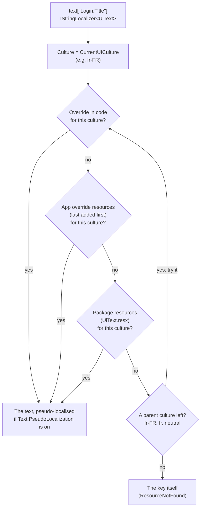
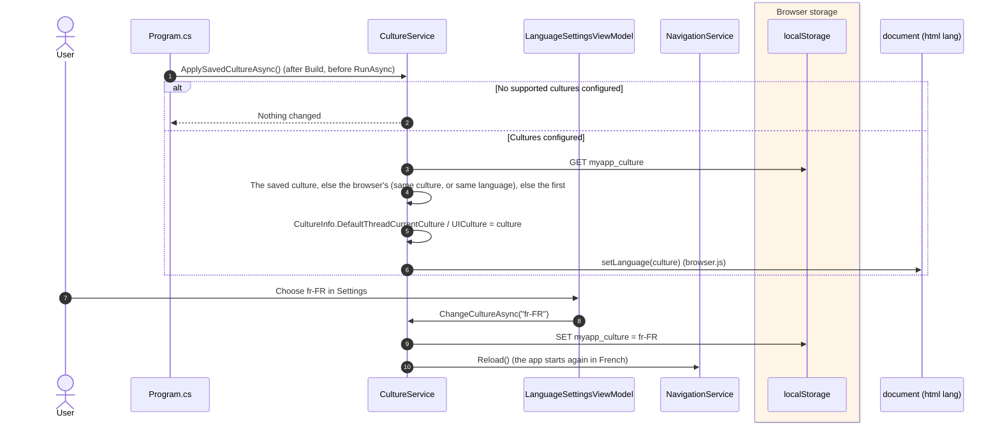
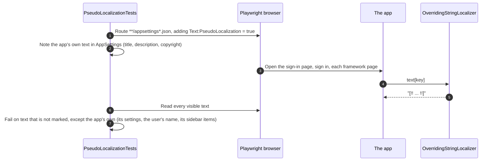

# Text: overrides, languages and pseudo-localisation

Every text the framework shows comes from resources (`.resx`), so an app can reword it and translate it: `UiText`
(`src/Devoctomy.Blazwiz.UI/Text/UiText.resx`) for the shell and its pages, `SyncUiText`
(`src/Devoctomy.Blazwiz.UI.Sync/Text/SyncUiText.resx`) for the sync module. The packages ship the neutral (English)
text only. Views and view models read it through `IStringLocalizer<UiText>` and the like, and error codes through
`IErrorText`.

Main classes:

- `OverridingStringLocalizerFactory` and `OverridingStringLocalizer` (`src/Devoctomy.Blazwiz.Core/Text/`): replace the
  standard `IStringLocalizerFactory`, so every `IStringLocalizer<T>` looks in the app's text first
- `TextBuilder` and `TextOptions` (`src/Devoctomy.Blazwiz.Core/Text/`), set up with `AddBlazwizText(text => ...)`:
  overrides, languages, plural rules, pseudo-localisation
- `TextPlurals` (`ITextPlurals`): which plural form a count takes in a language
- `ErrorText` (`src/Devoctomy.Blazwiz.UI/Text/ErrorText.cs`): describes a `BlazwizException`'s code from the resources
  registered with `AddErrorText<TResource>()`
- `CultureService` (`src/Devoctomy.Blazwiz.UI/Services/CultureService.cs`): the language at startup and its choice in Settings
- `FrameworkText` (`src/Devoctomy.Blazwiz.Testing/FrameworkText.cs`): checks an app's overrides in its tests

## 1. How a text is found

`OverridingStringLocalizer.FindUncached` looks for the key in the current UI culture first, then its parents
(`fr-FR`, `fr`, then the neutral text). In each culture it takes the first of:

1. an override set in code (`text.Override(key, text, culture)`),
2. the app's override resources (`text.AddOverrides<TResource>()`), the last added first,
3. the package's own resources.

So an app's French translation beats the package's English text, and the app's neutral (English) rewording is used
when no language more specific has the key. A key found nowhere shows as the key itself. Results are cached per
culture and key, until the overrides change.

Text with placeholders (`text["Session.Remaining", "04:59"]`) is formatted with the current culture after it is found.
Sidebar items name their resources (`NavigationItem.TextResource`) and keys, and `NavigationMenuService` reads them
on every call, so the current language and overrides apply.

## 2. Overriding the framework's text

The template's notes example is an app override: `AddBlazwizText(text => text.AddOverrides<NotesText>())` with
`NotesText.resx`, whose keys are framework keys (for example the sync module's "files" wording) with the example's
own words. An app adds its translations the same way, as `MyText.fr.resx` beside `MyText.resx`.

An upgrade can rename or remove a key, or change its placeholders, and an override of it would silently stop working.
`FrameworkText` (Testing) catches both in the app's tests:

| Method | Finds |
|---|---|
| `UnknownOverrideKeys(typeof(MyText))` | Keys in the app's neutral overrides that are not framework text (never used) |
| `MismatchedOverridePlaceholders(typeof(MyText))` | Overrides whose placeholders (`{0}`) differ from the framework text's (wrong values, or a format error) |

## 3. Choosing the language

The languages an app offers are `Text:SupportedCultures` in `wwwroot/appsettings.json` (for example
`["en-GB", "fr-FR"]`), which `AddBlazwizUi` passes to `text.SupportedCultures(...)`. The first is the default. With
none set the app follows the browser and Settings shows no choice. `Program.cs` applies the language before the app
starts, because Blazor WebAssembly reads it once.

`LanguageTests` (template UI tests) covers choosing French, the reload, and the language being remembered.

## 4. Pseudo-localisation

`Text:PseudoLocalization` (testing only) makes `AddBlazwizUi` call `text.UsePseudoLocalization()`: every text found
in resources is shown with its letters accented and wrapped, for example `[!! Šéššîöñ 04:59 !!]`, leaving
placeholders alone. Text on screen that is not marked like that did not come from resources, so it cannot be reworded
or translated.

The template's UI tests run it on the sign-in page, the password reset and every framework page.
