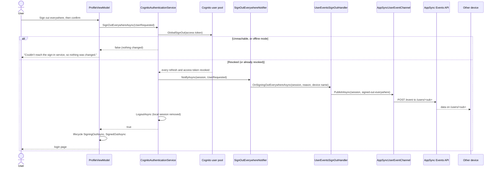
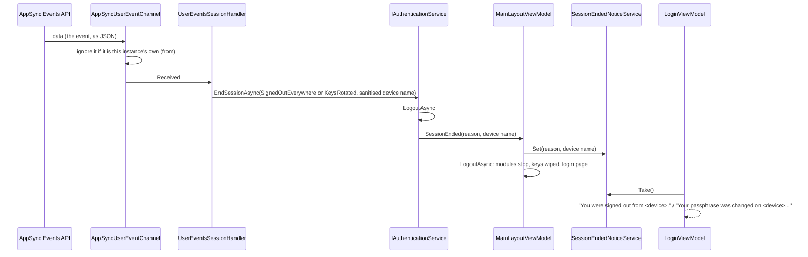

# User events: signing out everywhere

A user's open instances of the app (tabs and devices) share an event channel, so one can tell the others that
something changed. The first event is "signed out everywhere". It is sent when the user asks for it on the Profile
page, and (from the key rotation plan) when their passphrase changes.

Events only make things happen sooner. An instance that is closed, offline or in the background when an event is sent
never receives it: mobile browsers freeze a backgrounded app and drop its connection, and AppSync Events keeps nothing
to replay. The sign-in service is the durable record: `GlobalSignOut` revokes every session, and each instance checks
its session when it resumes.

| Part | Package | Class |
|---|---|---|
| Sign out everywhere, end a session from elsewhere, the resume check | Auth, Auth.Cognito | `IAuthenticationService` (`SignOutEverywhereAsync`, `EndSessionAsync`, `CheckSessionAsync`), `CognitoAuthenticationService`, `LocalAuthenticationService` |
| Hooks other packages implement | Auth | `ISignOutEverywhereHandler`, run by `SignOutEverywhereNotifier` |
| Checking the session when the app resumes | Auth, Browser | `SessionResumeMonitor` (started by `SessionResumeSessionHandler`), `PageResumeService` (`js/page-resume.js`) |
| The device's name | Browser | `DeviceNameService` (`js/device.js`), local storage `device_name` |
| The channel | Events, Events.AppSync | `IUserEventChannel`: `LocalUserEventChannel` (`BroadcastChannel`), `AppSyncUserEventChannel` (`js/appsync-events.js`) |
| Connecting, receiving, publishing | Events | `UserEventsSessionHandler`, `UserEventsSignOutHandler` |
| The button, the messages, the Settings section | UI | `ProfileViewModel`, `MainLayoutViewModel`, `SessionEndedNoticeService`, `LoginViewModel`, `DeviceSettingsViewModel` |

Nothing depends on `Events` but the app: `Auth` defines the hooks, `Events` implements them, and `UI` only talks to
`Auth`. Without `Events` (an app created with `--events false`), the Profile page does not offer the button, because
`SignOutEverywhereNotifier.HasHandlers` is false. `SignOutEverywhereAsync` still works for key rotation:
`GlobalSignOut` revokes every session, and the resume check signs other devices out when they next wake.

## 1. Signing out everywhere



The event is `{ "type": "signed-out-everywhere", "reason": "user-requested" | "keys-rotated", "device": "<name>",
"at": "<time>", "from": "<instance id>" }`. It carries no tokens, keys or file names. The `users` namespace's handlers
refuse any channel but the caller's own `/users/<sub>`.

## 2. Receiving it



## 3. Devices that miss it: the resume check

```mermaid
sequenceDiagram
    participant Browser as Browser (page-resume.js)
    participant Resume as PageResumeService
    participant Monitor as SessionResumeMonitor
    participant Auth as CognitoAuthenticationService
    participant Cognito as Cognito user pool
    participant Handler as UserEventsSessionHandler

    Browser->>Resume: visible again, or back online
    Resume->>Monitor: Resumed
    Monitor->>Auth: CheckSessionAsync()
    Auth->>Auth: GetCurrentUserAsync (renews or ends the session when due)
    Auth->>Cognito: GetUser(access token)
    alt Revoked (NotAuthorizedException)
        Auth->>Auth: EndSessionAsync(Revoked): "You were signed out."
    else Accepted
        Auth-->>Monitor: true
        Monitor->>Handler: SessionResumed
        Handler->>Handler: reconnect the channel if it dropped
    else Unreachable, throttled, or offline mode
        Auth-->>Monitor: true (kept; checked again next time)
    end
```

An instance that stays open and in use but silently loses its connection misses the event and passes no resume. It
finds out at its next token renewal, at most `AccessTokenValidity` (60 minutes) less the 5-minute renewal margin
(`CognitoAuthenticationService.TokenRefreshMargin`). A frozen instance runs no code, so it is no risk while it sleeps.
The resume check and a sync started by the same resume run side by side, so one sync pass can run before the check
signs a revoked instance out. That pass syncs the user's own files under keys they still hold.

## 4. The connection

`UserEventsSessionHandler` connects the channel when the session starts (`OnSessionStartedAsync`). It does not
connect for an offline session, or while offline mode is on, because offline mode makes no network calls. When the
connection drops it reconnects with backoff (`FirstReconnectDelay` doubling up to `MaxReconnectDelay`), and straight
away after a resume whose check passed. It disconnects on sign out.

`AppSyncUserEventChannel` connects to `wss://<Events:RealtimeEndpoint>/event/realtime` with the subprotocols
`aws-appsync-event-ws` and `header-<base64url of { host, Authorization }>`. It then sends `connection_init`, waits
for `connection_ack`, and subscribes to `/users/<sub>`. The `ka` keep-alives reset a timer, and if they stop the
connection is closed and reconnected. Publishing is `POST https://<Events:HttpEndpoint>/event`, authorised with the
session's Cognito access token.

`AddBlazwizAppSyncEvents` picks the channel:

- When the `Events` settings are present, the AppSync channel.
- Without them in development, `LocalUserEventChannel`, which reaches this browser's other tabs only (the UI tests
  use it).
- Without them anywhere else, no channel, and `MissingEventsConfigurationWarning` logs that the app runs without
  events.

## 5. The device's name

`DeviceNameService` keeps a name for this browser in local storage (`device_name`). Until the user renames it under
Settings, This device, it is made on first use as `<Platform>-<Browser>-<6 random digits>`, e.g.
`Android-Edge-624834`. Platform and browser are a best guess from `navigator.userAgentData` or the user-agent string,
with `Unknown` when not recognised. The name is only ever sent in events on the user's own channel. Receivers
sanitise it (control characters removed, cut to 32 characters) and show it as plain text.
